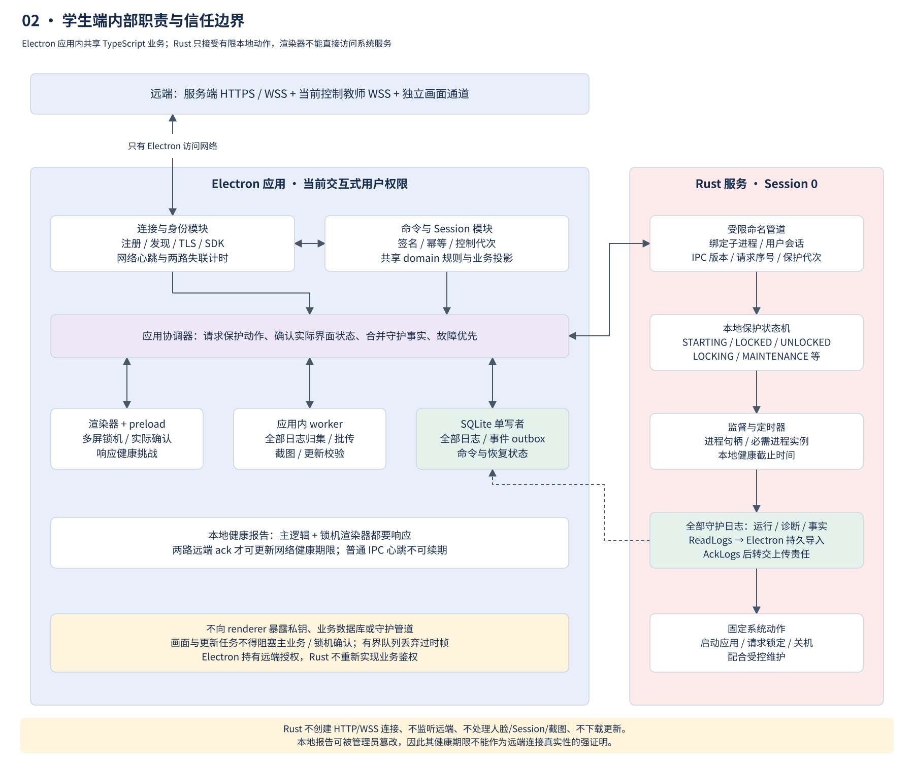
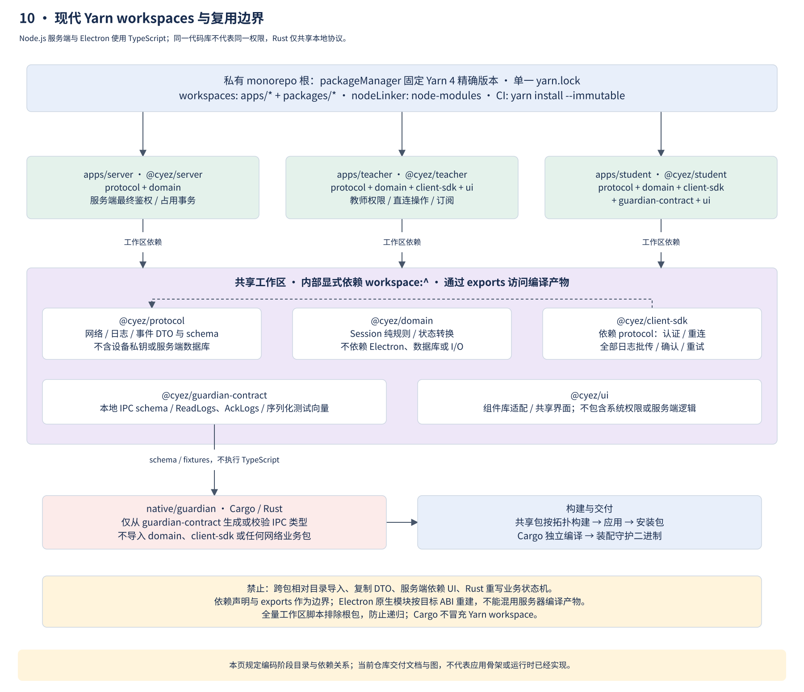
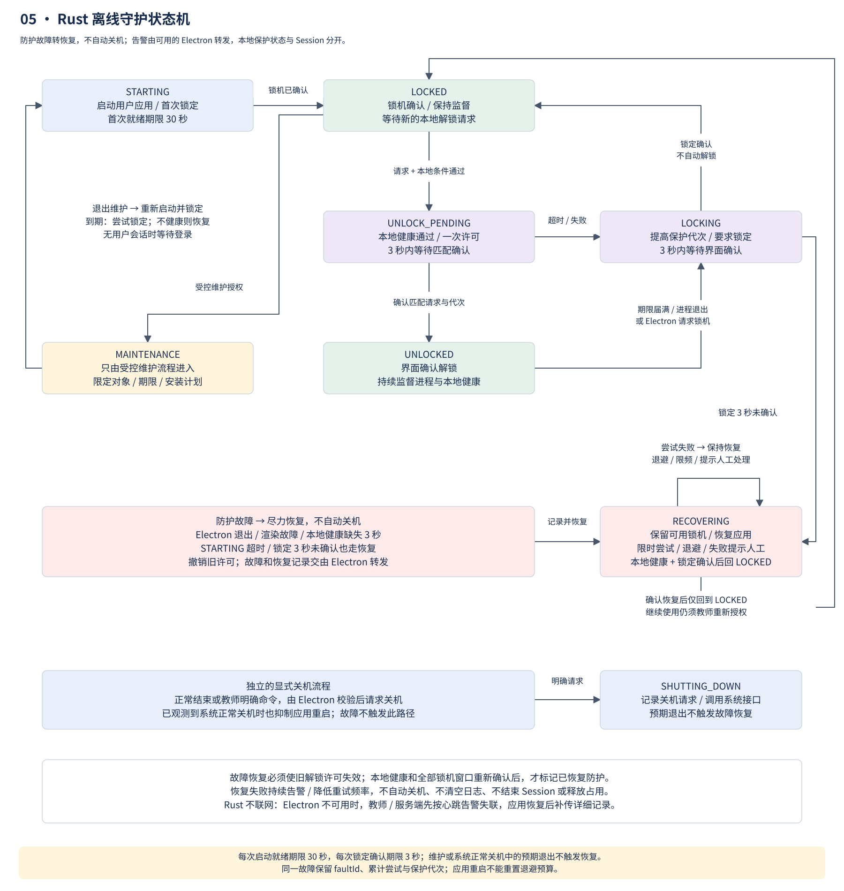
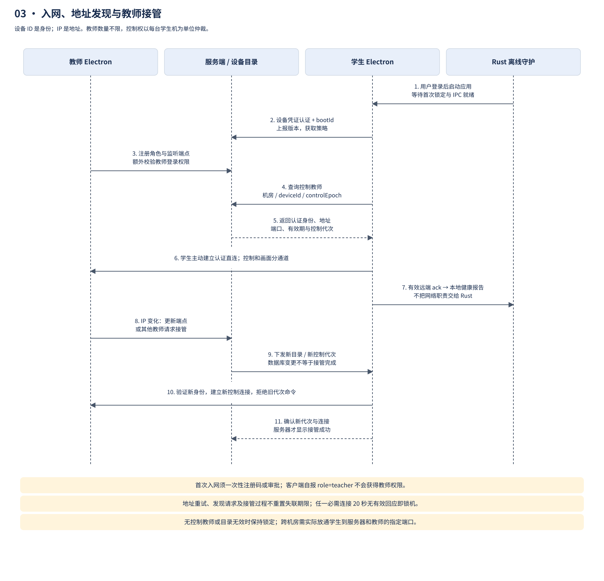
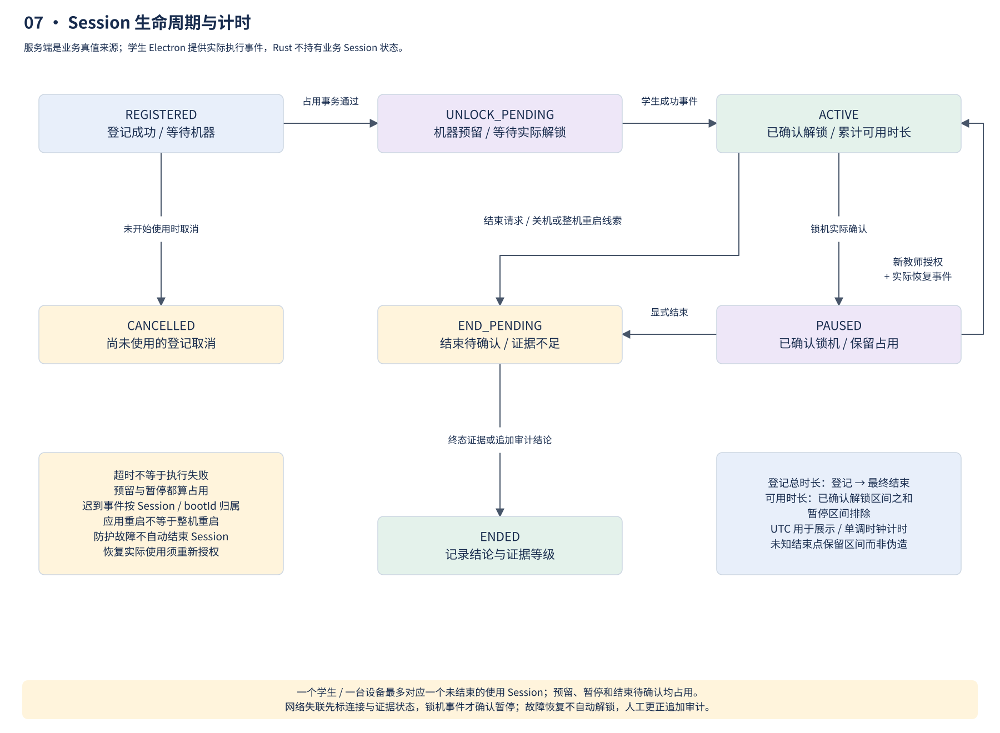
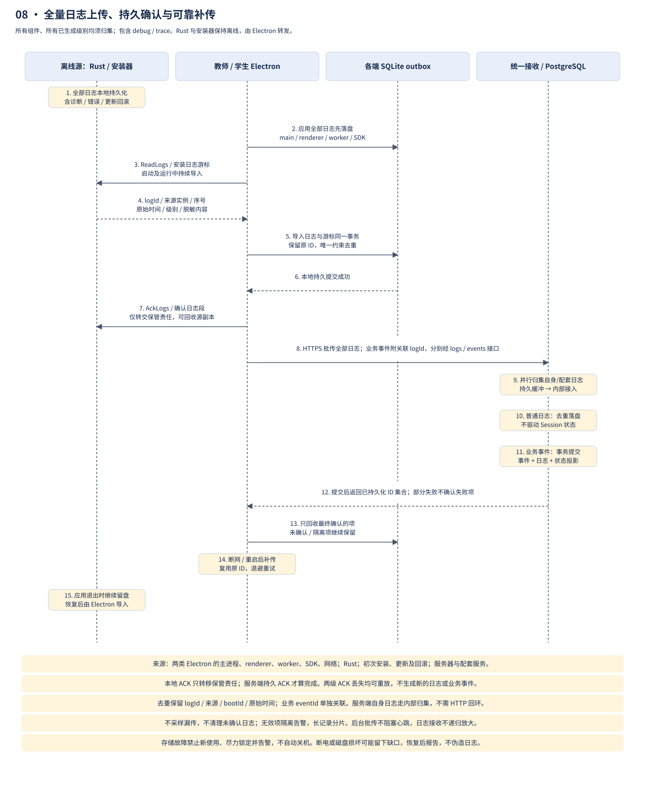
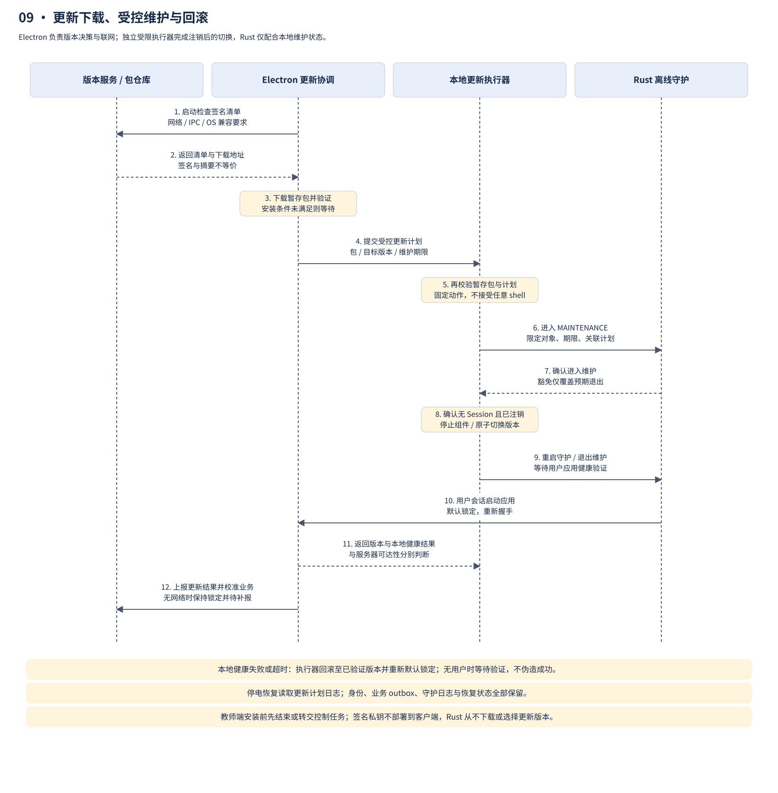

# 学校图书馆机房管理系统架构设计

设计基线：2026-10-23。状态：设计已整理，业务代码尚未实现。学生端主要逻辑位于 Electron，Rust 仅为离线守护进程；采用 TypeScript / Yarn workspaces 复用，并把设备数量定义为负载测试基线。架构展开为十页详细图，所有组件的全部日志统一归集到服务端，并明确离线缓存、补传和持久确认。本文件是行为与接口约定的主要依据；图片与可编辑图应随本文件同步更新。

## 目标、约束与范围

系统服务于多个机房，不对学生端、教师端或机房数量设置产品上限。首轮负载测试使用 200 台学生机和 2 个教师端；该规模不是许可限制、协议限制或写死的数组大小，也不意味着单节点有无限容量。实际容量受硬件、数据库、网络和画面订阅量影响，扩容前按目标负载验证。服务端 IP 固定，教师端 IP 可以变化，学生端启动时从服务端发现当前控制教师。

- 学生机仅假定运行 Windows 10 或更高版本，不依赖特定版本类型的专属能力。具体 Windows 构建、架构、Electron 支持范围、显卡和读卡器列入部署兼容性测试；不将“Windows 10+”等同于所有旧构建均已兼容。
- 学生持有管理员权限；仅实现 Rust 服务层的尽力防护，不开发驱动，不承诺管理员无法绕过。
- 学生端主要逻辑位于 Electron 应用内，服务端和两类 Electron 客户端统一使用 TypeScript，通过现代 Yarn workspaces 复用代码；Rust 仅执行固定的离线守护功能与本地状态机。
- 网络心跳每 1 秒一次，连续 20 秒未收到有效回应即收回使用权限。必需进程退出即锁机。
- 首版包括录入、识别接入、分配机器、Session、屏幕墙、管理命令、活动日志、服务器管理及自动更新。
- 本系统各组件产生的全部日志都必须上传或在服务端内部接入统一存储，包含业务、审计、运行、诊断、网络、守护、安装与更新日志；已生成的 debug/trace 也不能仅留本地。
- 人脸算法、摄像头 SDK、读卡器 SDK 和具体 UI 库不在本次实现范围；定义接口，后续接入。首版不含远程键鼠控制、视频录像和高可用集群。

## 总体架构与职责


[可编辑源文件](architecture.drawio)包含十个页面，见[图册索引](diagrams.md)。服务端是业务状态、授权和全部日志的中心；教师与学生直连承载命令和画面，两类 Electron 分别直接向服务端上传本机全部日志，学生 Electron 同时转发离线 Rust 日志。

### 职责与数据所有权

| 能力 / 数据 | 服务端 TypeScript | 教师 Electron | 学生 Electron | Rust 离线守护 |
| --- | --- | --- | --- | --- |
| 网络与设备身份 | 签发、验证、吊销、设备目录 | 注册、登录、SDK、直连监听 | 注册、发现、SDK、全部远端连接 | 无远端连接、无业务网络凭证 |
| Session 与使用时长 | 权威状态、占用事务、汇总 | 登记、分配、操作、展示 | 业务状态投影、实际区间、事件 | 不计算，仅保留不透明关联 ID |
| 命令 | 鉴权、签名、控制代次 | 申请授权、发送、查询结果 | 签名校验、幂等、实际执行协调 | 固定动作、本地健康和保护代次 |
| 锁机与进程监督 | 仅展示已报告状态 | 授权操作 | 窗口与渲染确认、网络故障判断 | 监督应用和必需进程、超时、系统动作 |
| 日志 | 统一接收所有来源及级别、自身日志归集、PostgreSQL 去重与查询 | 全部应用/安装日志、SQLite outbox、直传补传、授权查询 | 全部应用/守护/安装日志、SQLite outbox、直传补传 | 全部守护日志本地持久化，交由 Electron 上传，无网络发送 |
| 屏幕 | 订阅授权，不转发画面 | 订阅、展示、过时提示 | 采集、压缩、独立通道传输 | 不参与 |
| 更新 | 签名清单与包仓库 | 检查、下载、校验、协调 | 检查、下载、校验、协调 | 只配合受控维护状态 |

服务端 Session、Electron 业务投影和 Rust 本地保护状态是不同状态机。`UNLOCKED` 不等于服务端已收到成功事件；“在线”也不等于已获准使用。教师界面分别展示连接、保护、Session 和命令确认状态，不用单一布尔值混为一谈。

### 服务端

采用 Node.js / TypeScript 模块化单体服务、PostgreSQL 和独立更新包文件仓库。接口使用 HTTPS/WSS；与 Electron 共用工作区中的协议、运行时校验及纯业务规则。服务端框架后续选定，语言和代码复用方向已确定。

| 模块 | 职责 |
| --- | --- |
| 设备注册与目录 | 入网审批、设备凭证、角色、机房、版本、启动报告、当前地址、教师发现 |
| 权限与控制权 | 教师账号权限、设备角色、机房授权、单机操作权、控制代次与命令授权 |
| 学生与人脸资料 | 学生档案、卡 UID、换卡记录、人脸资料及算法版本 |
| Session | 登记、机器预留、解锁确认、暂停区间、结束与待核实事项 |
| 状态与日志 | 接收教师/学生及其代理上传的全部日志，归集服务端自身日志；业务事件去重与投影、统一查询、人工更正审计 |
| 策略与版本 | 必需进程策略、签名更新清单、安装包、升级状态与回滚信息 |
| 运行管理 | 运行状态、备份恢复、容量、告警、证书和凭证生命周期 |

首轮在单节点上验证 200 个学生连接、2 个教师连接；设备目录、机房分组和教师授权按集合与分页处理，不硬编码数量。心跳状态在内存维护，只将状态转换和必要快照持久化。服务端重启后将连接状态视为待确认，重新建立连接并校准，不沿用过期的“在线”状态。更大负载需实测与容量规划；后续多节点部署必须补充共享操作权和连接路由，不能直接把单节点内存状态横向复制。

服务器是首版的单点依赖：其故障持续 20 秒会使学生端锁机。维护计划必须与实际使用协调，不能在监控中将这种锁机误认为学生违规。

### 教师端

Electron 主进程负责网络、设备凭证、硬件适配和直连监听；渲染进程只通过收窄的 IPC 接口调用这些能力，不获得任意系统命令、文件读写或数据库权限。

| 界面 | 功能 |
| --- | --- |
| 录入与登记 | 读取饭卡 UID、人工录入姓名等资料、采集与绑定人脸、日常识别、待分配队列 |
| 监控与操作 | 机房筛选、屏幕墙、单机放大、学生与 Session 状态、锁定/解锁、结束使用、关机、异常原因 |
| 服务器管理 | 设备审批、账号与机房授权、必需进程策略、版本发布、日志、运行状态、备份恢复 |

服务器管理操作由服务端重新鉴权，并写入审计日志。教师设备身份不自动赋予所有服务器管理权限。UI 通过组件适配层组织，具体组件库后续选定。

教师端也使用本地 SQLite 日志 outbox。主进程、渲染器、worker、硬件适配、SDK、网络连接和安装/更新产生的全部日志，由主进程或应用内日志工作进程归集、持久化并直接上传服务端；未登录教师账号时仍可凭教师设备身份补传本机日志，但不能借此获得查询或管理权限。

### 学生端



- **Electron 主进程及应用内工作进程（TypeScript）**：持有设备网络身份，负责注册与教师发现、全部 HTTPS/WSS 连接、网络心跳、命令授权与幂等校验、Session 本地业务状态、策略同步、日志补报、画面传输和更新协调。复用服务端与教师端的共享包，计算或存储重任务从主事件循环隔离。
- **Electron 渲染进程**：显示锁机界面、参与屏幕采集并确认实际界面状态，通过受限 preload 与主进程通信；不直接访问设备私钥、数据库和守护 IPC。解锁时隐藏锁机窗口而不是结束应用，以便持续监督。
- **Rust 离线 Windows 服务**：开机启动，管理交互式会话中的 Electron 生命周期，监督 Electron 和必需进程，通过本地状态机约束锁定/解锁切换、超时及受控维护，执行固定的关机等系统动作，持久记录全部守护日志，包括本地事实、诊断和错误。没有 HTTP/WSS 客户端或远程监听，不负责注册、教师发现、业务命令鉴权、Session 计算、日志网络上报、截图或更新下载；全部日志由 Electron 导入后上传服务端。
- **Electron 管理的本地 SQLite**：保存本机全部待上传日志、待发送业务事件、已处理命令和恢复所需状态，由应用的单一存储模块写入；Rust 使用独立的本地日志缓冲，不并发写业务数据库。渲染器/worker 的日志通过受限适配器交接，不能仅写控制台或内存。设备凭证及更新信任材料单独保护，更新不能重新生成设备身份。

Windows 服务运行在 Session 0，不能直接承担用户桌面界面。服务管理当前交互式用户会话中的 Electron，并通过带 ACL 的命名管道通信；管道绑定会话及子进程身份，不以进程名或客户端自报身份建立信任。Electron 不因有守护服务而以 SYSTEM 身份运行；设备通信与业务权限留在 Electron 主进程，SYSTEM 仅承担所需的本地系统动作。

守护服务跟随用户登录、注销管理应用生命周期，Electron 跟随显示器变化管理覆盖窗口；开机、登录和重启后默认锁定。会话切换、远程登录及多显示器必须验证，不能让新会话因缺少覆盖窗口获得未授权使用。

### TypeScript 与现代 Yarn workspaces



采用 Yarn 4.x（现代 Yarn，非 Yarn Classic）monorepo。以下为待编码时落地的工程约定，本次只更新文档和图，不创建空应用或声称工程已经实现。

```text
apps/
  server/                 # @cyez/server：Node.js / TypeScript 服务端
  teacher/                # @cyez/teacher：Electron 教师端
  student/                # @cyez/student：Electron 学生端主要逻辑与界面
packages/
  protocol/               # @cyez/protocol：网络消息、日志/事件 DTO、运行时校验
  domain/                 # @cyez/domain：纯业务规则与 Session 转换规则
  client-sdk/             # @cyez/client-sdk：HTTPS/WSS、认证、全量日志批传、重试与去重
  guardian-contract/      # @cyez/guardian-contract：版本化本地 IPC schema / 测试向量
  ui/                     # @cyez/ui：教师端和学生端的 UI 适配与共享组件
native/
  guardian/               # Rust Cargo crate：离线守护进程
```

根 `package.json` 使用如下配置；`4.18.1` 是已核对存在的 Yarn 4.x 固定版本示例，实施时通过 Electron 打包与依赖安装验证后固定精确版本，不使用浮动的 `latest`：

```json
{
  "name": "cyez-library-management",
  "private": true,
  "packageManager": "yarn@4.18.1",
  "workspaces": ["apps/*", "packages/*"],
  "scripts": {
    "build": "yarn workspaces foreach -A --exclude cyez-library-management --topological run build",
    "typecheck": "yarn workspaces foreach -A --exclude cyez-library-management run typecheck",
    "test": "yarn workspaces foreach -A --exclude cyez-library-management run test"
  }
}
```

内部依赖明确声明，如 `"@cyez/protocol": "workspace:^"`，不使用相对目录跨包导入或复制代码。根脚本遍历工作区时排除根包，避免再次执行自身产生递归。根目录维护单一 `yarn.lock`，CI 使用 `yarn install --immutable`；构建工具环境按 `packageManager` 配置 Yarn，CI 显式准备 Corepack 或等效的版本化 Yarn 启动器，不假定 Node.js 自带它。

`.yarnrc.yml` 选择 `nodeLinker: node-modules`，便于 Electron 打包与原生模块重建；这是现代 Yarn 的受支持链接模式，仍使用 Yarn 4 的 workspaces 与 `workspace:` 机制，不退回 Yarn Classic。各工作区通过包导出边界引用编译产物，按依赖顺序构建，部署只携带目标应用及其运行时依赖。

直接依赖遵守以下最小集合；实际使用时每个包仍需显式声明自己的依赖，不能依赖 hoisting 带来的偶然可见性：

| 工作区 | 内部依赖 / 边界 |
| --- | --- |
| `@cyez/server` | `protocol`、`domain`；不依赖 Electron、UI 或守护执行器 |
| `@cyez/teacher` | `protocol`、`domain`、`client-sdk`、`ui` |
| `@cyez/student` | `protocol`、`domain`、`client-sdk`、`guardian-contract`、`ui` |
| `@cyez/client-sdk` | `protocol`；不引入服务端数据库、UI 或全局业务权限 |
| `@cyez/domain` / `@cyez/protocol` | 独立、无跨层 I/O；业务类型与传输 DTO 在应用边界映射，避免循环依赖 |
| `@cyez/guardian-contract` | 本地 IPC schema、版本、测试向量；无 Session 业务计算 |
| `@cyez/ui` | 界面组件与适配；通过应用注入行为，不直接发系统命令 |

每个应用有独立构建与运行目标，服务端 Node.js 版本不必等于 Electron 内嵌 Node.js，但共享代码必须满足两者支持范围。原生模块分别针对服务端 ABI 和 Electron 目标 ABI 构建，不能因为工作区同语言就混用同一原生二进制。开发时可定向运行 `yarn workspace @cyez/student <script>`，发布构建则使用锁文件及依赖拓扑保证可复现。Yarn 只管理源码依赖，不作为客户端在线热更新机制。

`protocol`、`domain` 不依赖 Electron、数据库或 Node.js 特定 I/O，供服务端和客户端共同使用；共享校验只复用规则，最终权限和占用事务仍由服务端执行。`client-sdk` 放在 Electron 主进程或应用内工作进程使用，`ui` 只负责界面，服务端不引用它。

Rust 由 Cargo 构建，不伪装成 JavaScript workspace；应用构建编排调用 Cargo 并将守护二进制装入安装包。Rust 只共享本地 IPC 的版本化 schema 和序列化测试向量，不导入 TypeScript 业务包；双方结构通过 schema 生成或校验保持一致，避免再用 Rust 重写 Session 和网络协议逻辑。

### Rust 离线守护状态机与本地接口



Rust 的“离线”指不参与任何远程通信，并非只在断网时运行。Electron 调用有限的本地接口：握手/心跳、读取状态、应用必需进程配置、请求/确认解锁、请求/确认锁定、请求关机、受控维护、读取/确认全部守护日志；禁止任意 shell、任意路径执行和任意文件操作。

本地 IPC 使用有长度上限的分帧消息，先握手确定版本再交换业务；双方采用同一 schema 和测试向量验证。公共头包含 `ipcVersion`、`requestId`、应用实例标识、守护实例标识、用户会话标识和 `protectionEpoch`；远端 `controlEpoch` 由 Electron 管理，不与本地保护代次混用。旧实例、过期代次、未知动作和字段类型错误均拒绝，不能宽松回退到任意命令执行。

| 本地接口族 | 方向与必要语义 |
| --- | --- |
| `Hello` / `GetState` | Electron ↔ Rust：协商版本、当前实例、状态和保护代次；重启后重新握手 |
| `HealthChallenge` / `HealthReport` | Rust 发挑战，Electron 返回主逻辑与渲染器响应、两路健康序号和剩余期限 |
| `ApplyProcessPolicy` | Electron → Rust：经过业务授权的版本化必需进程列表；运行中缺失即锁机，维护变更另走流程 |
| `RequestUnlock` / `ConfirmUnlocked` | Electron → Rust：获取一次本地许可，再确认实际界面结果；Rust 可以因新故障拒绝迟到确认 |
| `RequireLock` / `ConfirmLocked` | Rust → Electron 要求显示锁机，Electron 回报实际状态；Electron 也可主动提出锁定 |
| `RequestShutdown` | 已校验的 Electron 或本地故障触发：固定动作、有限原因、可选关联 ID |
| `ReadLogs` / `AckLogs` | Electron 按来源实例和连续游标拉取全部守护日志，SQLite 持久事务提交后才确认本地交接；不表示服务端已收到 |
| `BeginMaintenance` / `EndMaintenance` | 受控更新执行器 / 维护入口：绑定已验证计划、对象与期限，普通 renderer 无权调用 |

| 本地状态 | 进入条件与动作 |
| --- | --- |
| `STARTING` | 当前用户会话启动 Electron，等待 IPC 与首次锁定确认；启动就绪期限默认 30 秒，超时请求关机；没有交互式用户时不运行该期限 |
| `LOCKED` | 界面已确认锁定；保持进程监督，不因进程重启或网络恢复自动解锁 |
| `UNLOCK_PENDING` | Electron 已完成业务鉴权并提出请求；Rust 检查本地健康及锁定代次，批准一次界面切换，3 秒内等待实际解锁确认；失败回到锁定流程 |
| `UNLOCKED` | 界面切换已确认，本地监督正常；没有学生资料或 Session 业务状态 |
| `LOCKING` | 网络期限届满、必需进程退出或 Electron 请求锁定；发送锁定要求，3 秒内未确认则请求关机 |
| `MAINTENANCE` | 经受控安装/维护流程进入，限定对象和期限；退出时重新进入默认锁定流程；豁免到期按当前进程与界面实际健康处置 |
| `SHUTTING_DOWN` | 关机前写本地守护事件并执行系统动作，避免将预期进程退出再次当作故障 |

`UNLOCKED` 等表示本机保护状态，不能替代服务端 Session 状态。Electron 保存并校验 Session、`controlEpoch`、业务命令和签名；Rust 仅维护本地保护代次、请求序号和有限结果，防止旧 IPC 解锁或确认覆盖新锁定要求。故障、重新登录及守护重启使旧解锁请求失效。Rust 进入 `SHUTTING_DOWN` 后不再接受解锁。

保护代次必须贯穿主进程到 preload/renderer 的界面切换指令及确认；渲染器不能在已经处理较新锁定要求后，再执行排队中的旧解锁指令。守护报告本地许可失效、IPC 断开或实例变化时，Electron 先显示锁定界面再进行状态校准，不能仅依靠最后一次缓存的 `UNLOCKED` 继续放行。

网络心跳及失联判断由 Electron 实现。为让守护状态机具有独立的本地超时，Electron 在每次有效远端 ack 后分别保留服务器、控制教师两个通路的健康序号及剩余有效期（最多 20 秒）。Rust 的每秒健康挑战记录本地发送时刻，Electron 响应该挑战时计算剩余期限，Rust 将它锚定到挑战发送时刻而非接收时刻，以保守扣除 IPC 往返延迟；挑战过期、健康序号重复或旧实例的报告不能续期。正常运行时 Electron 按最后有效 ack 精确判断 20 秒，守护兜底可能提前一个本地 IPC 往返耗时，不会因排队把 20 秒延长。测试分别验证这一保守边界和普通断网的 20 秒行为。

Rust 只维护本地单调时钟截止时间，不发网络包、不验证远端协议或处理教师身份。普通 IPC 心跳、地址重试和读取状态不延长网络健康期限；任一期限届满可独立进入锁定流程，且不重复刷新正在等待的 3 秒锁定确认期限。无有效健康期限时默认不可解锁。长期断网只重复记录必要状态变化，不形成无限关机/日志循环。

本地每秒心跳必须反映 Electron 主逻辑和锁机渲染进程的有效响应，不能由独立定时器在界面卡死时继续报“健康”。主进程非预期退出、受监督渲染进程故障或连续 3 秒无有效健康回应时，Rust 离线记录并请求关机。它信任受约束的本地 Electron 报告，不具备证明远端连接真实健康的能力，不能据此宣称可抵抗管理员篡改 Electron。

守护记录全部运行、诊断、状态转换、进程监督、IPC、维护及关机日志，包含稳定 `logId`、级别、来源实例、启动/用户会话标识、序号、原因和可选的不透明业务关联标识，不计算学生使用时长。Electron 拉取全部记录，持久化到 outbox 后用 `AckLogs` 确认本地接收，Rust 方可回收已交接记录；网络上传责任此时转交 Electron，最终仍须服务端持久确认。应用已退出而无法上报时，日志留待下次启动导入补传；记录故障不能无限阻塞关机动作。

## 设备身份、注册与发现



### 身份模型

设备身份由稳定的 `deviceId`、设备证书和角色组成；每次开机生成 `bootId` 区分跨启动事件。教师登录账号独立于教师设备身份。IP 仅是路由信息，不能用来判断设备身份或角色。

`bootId` 表示设备启动周期；Electron 和守护各自另有进程实例标识。仅重启应用不能冒充新设备，守护重启也不能复用旧的本地许可。日志保留原始启动和实例关联，导入后不重新编号伪造成当次事件。

首次入网使用由管理端发放、绑定角色和机房的一次性注册码，或先进入待审批状态。服务端批准后签发设备凭证；后续启动仅报告和验证身份，不重新自行选择角色。角色变更、吊销及重新入网都留审计记录。

连接采用 TLS，设备接口使用双向设备认证，教师业务接口额外检查登录账号权限。安装配置预置服务端地址及信任根，不能接受任意广播地址或跳过证书校验。私钥的本机保护属于尽力防护，不能保证对本地管理员保密。

### 启动和地址更新

1. Rust 在本地启动和监督学生 Electron；学生及教师 Electron 主进程使用安装配置连接固定服务端地址，验证服务器身份。Rust 不连接网络。
2. 报告 `deviceId`、`bootId`、角色、版本、机房和可达端点，服务端返回策略、协议兼容信息及注册结果。
3. 教师端绑定 LAN 接口并报告其直连地址和端口；网络接口变化时重新注册，服务器同时记录请求来源供核对，不假定多网卡上所有地址都可达。
4. 学生端查询当前控制教师的设备标识、端点、证书身份、控制代次和有效期，再主动连接教师端的 WSS 接口。
5. 教师地址变化或直连失败时，学生重新查询目录并重连。重试、获取目录或建立 TCP 连接不能代替有效应用层心跳。

学生端不依赖广播寻找服务器；固定地址由安装配置提供。跨机房需允许学生到服务器以及学生到教师指定端口的连接；服务器目录解决寻址，不能穿透网络隔离。发现条目过期、身份不匹配或无控制教师时保持锁定。

## 通信协议与接口边界

### 三条通信路径

| 路径 | 传递内容 | 约束 |
| --- | --- | --- |
| 教师 ↔ 服务端 | 录入、识别结果、状态/日志查询、全部本机日志上传、Session、操作权、命令授权、管理、心跳 | 主进程归集应用及安装日志，直接持久上传；业务状态由服务端保存与鉴权 |
| 学生 Electron ↔ 服务端 | 启动报告、教师发现、策略、心跳、全部本机日志上传、学生事件、命令结果、更新 | 包含应用、Rust、安装/更新全部日志；Electron 直接上传，不依赖教师转交 |
| 学生 Electron ↔ 教师 | 管理命令、执行回执、心跳、屏幕缩略图 | Electron 主动建立双向连接；控制与画面使用独立通道 |

API 使用 `/api/v1` 前缀的 HTTPS JSON；WSS 在 HTTP 升级连接后使用版本化消息。心跳为带序号的应用层 ping/ack，校验会话和序号，旧回应不能反复续期。命令和事件均使用有限大小消息与限长队列。

| 接口组 | 主要操作 |
| --- | --- |
| `devices` / `discovery` | 入网、启动报告、地址更新、状态、当前控制教师查询 |
| `students` / `face` | 学生资料、UID 绑定与换卡、人脸登记与识别适配 |
| `sessions` | 登记、预留机器、申请解锁、暂停、恢复、结束 |
| `control` / `commands` | 申请或转移操作权、授权命令、结果确认和查询 |
| `logs` | `/api/v1/logs/batch`：全量日志批传、逐项持久确认、重试；按权限查询来源、级别、关联和上传积压 |
| `events` | 业务事件批量上报、关联审计日志与状态投影的事务提交、持久确认、查询和审计更正 |
| `policies` / `updates` | 必需进程策略、版本清单、安装包、升级结果 |

消息至少携带协议版本、请求或事件标识、设备和启动标识。学生自己的事件上报只能影响自己的设备状态；日志中不接收客户端自报的教师权限。

### 多教师操作权与命令一致性

多名教师可查看各自获授权的设备，同一学生机仅有一名控制教师；教师总数不固定为两名。服务器事务性分配控制权，发放可续期的租约及单调递增的 `controlEpoch`。接管更新代次，并将最新代次推送至学生 Electron。

命令授权包含 `commandId`、动作、目标设备、`sessionId`、控制教师身份、`controlEpoch`、有效期和服务端签名。学生 Electron 同时验证教师连接身份、授权、当前 Session 和代次，并将需要的固定本地动作交给 Rust；Rust 不重做远程业务鉴权。相同 `commandId` 返回 Electron 已记录的结果，不能重复执行。

接管只有在学生确认最新代次并建立新教师连接后才算完成；旧代次一旦安装到学生端即被拒绝。服务器离线、学生无法同步新代次时，不把接管显示为成功，也不能仅凭服务器数据库更新就声称旧通道已失效。接管过程不消除连续失联期限。

教师点击操作、服务端授权、学生接收、学生执行是不同阶段。超时表示结果待确认，不等同于操作失败或成功；教师查询同一命令标识解决不确定结果。服务器失联时不能发起新的解锁；学生仍可本地执行故障锁定和关机。

## 学生资料与人脸接入

首次登记时读取饭卡 UID，不解密卡内容。UID 按字节顺序、长度保存，展示使用统一十六进制形式；不把不同长度或去掉前导零后的值混为同一张卡。读卡器适配器必须验证实际卡片是否提供稳定 UID。

系统生成独立的 `studentId`，姓名、班级等人工录入。一个有效 UID 只能绑定一个学生；学生换卡时撤销旧绑定并新增绑定记录，保持 Session 历史不变。UID 是卡凭证，不是不可复制的密码，不作为远程设备或教师身份认证材料。

人脸适配接口提供登记、识别、删除和算法版本查询。识别返回候选学生、置信信息及识别状态，业务层决定是否接受；失败或多候选不能自动解锁。教师可以对识别问题作人工核验，任何人工代登记必须单独授权并审计。

服务端集中保存人脸模板或供应方资料引用、格式和算法版本；若算法需要原始图像，另行明确保留与删除策略。学生端不保存全校人脸库。敏感资料加密存储、限制导出，并记录访问；日志不写入完整模板、原始图像或设备私钥。

## Session 与登记解锁流程


1. 教师录入完成首次档案，或通过人脸识别确认已有学生，创建待分配 Session。
2. 教师指定机器，服务端事务性检查学生和设备均无冲突，预留机器并记录待解锁命令。
3. 教师获得控制权和命令授权后，经直连向学生 Electron 主进程发送解锁命令。
4. Electron 使用共享协议和业务规则验证授权、当前控制代次及两条网络连接，持久化命令意图，并向 Rust 请求本地解锁许可。Rust 只检查必需进程、本地健康与保护代次，进入 `UNLOCK_PENDING`；Electron 收到许可后切换渲染界面，并将实际状态确认回 Rust。
5. Rust 确认本地状态为 `UNLOCKED` 后，Electron 持久化 `UNLOCK_SUCCEEDED` 事件，直接上报服务端并返回教师回执。服务端依据学生事件确认使用开始；只有 Rust 许可或只有教师回执均不等于使用已确认开始。
6. 网络或必需进程故障时锁机并暂停；恢复后由教师针对同一 Session 发放新的恢复授权。
7. 正常结束、关机、教师强制结束时关闭 Session；未收到确定证据时进入待确认状态。

### 状态与计时



| 状态 | 含义及下一步 |
| --- | --- |
| `REGISTERED` | 已确认学生，等待机器分配；可取消 |
| `UNLOCK_PENDING` | 已预留机器且命令待执行；重复请求复用同一命令 |
| `ACTIVE` | 学生端确认解锁，累计实际使用时间 |
| `PAUSED` | 锁机已确认，保留学生和机器绑定；教师重新授权才恢复 |
| `END_PENDING` | 已请求结束，或关机/重启线索提示使用终止，但终态证据尚不足 |
| `ENDED` | 已确认结束；保存正常、异常或无法确认的原因及证据等级 |
| `CANCELLED` | 尚未实际开始使用的登记被取消 |

同一学生及设备最多对应一个未结束的使用 Session，预留、暂停和结束待确认均算占用。暂停不自动释放座位；教师可以显式结束。待解锁命令超时也不能立即释放预留，必须通过学生状态校准或审计处置排除“已解锁但回执丢失”。

登记总时长从登记到最终结束，实际可用时长累加已确认解锁区间，排除暂停。学生端使用单调时钟记录同次启动内的区间，记录 UTC 时间用于展示；服务端保留接收时间，不能仅依赖可能被学生修改的本地系统时间。

网络失联时，服务器只能确认通信中断，不能声称锁机已经执行；状态显示“失联／锁机待确认”。补报后再修正实际使用区间，保留修正依据。骤然断电且无终态证据时，记录最后确认时间与可能结束区间，不伪造精确结束秒数。

连接可达性与 Session 状态分别维护：单纯网络超时不直接把 `ACTIVE` 改成 `END_PENDING`，先保留最后已确认业务状态并标注证据过期；收到实际锁机事件后改为 `PAUSED`。只有明确结束请求、关机事实或新启动表明原使用已中断时，才按证据进入结束流程。这样断网重连和补报不会被误当成一次新的登记或使用结束。

## 故障处置与关机证据


### 检测参数与动作

| 监督项 | 参数 | 故障动作 |
| --- | --- | --- |
| 学生 Electron ↔ 服务端 | 每 1 秒网络心跳，自最后有效回应起连续 20 秒 | Electron 请求锁机；Rust 本地健康期限同时兜底，有 Session 则由 Electron 记录暂停 |
| 学生 Electron ↔ 当前控制教师 | 每 1 秒网络心跳，自最后有效回应起连续 20 秒 | Electron 请求锁机；Rust 本地健康期限同时兜底，有 Session 则由 Electron 记录暂停 |
| 教师 ↔ 服务端 | 每 1 秒心跳，20 秒失联 | 撤去新操作入口，显示状态失效，重连后校准 |
| Rust ↔ Electron | 每 1 秒本地心跳，已就绪后连续 3 秒无有效响应；非预期退出立即检测 | Rust 本地记录防护故障并请求关机；启动就绪期限见本地状态机 |
| 必需进程 | Rust 订阅进程退出信号，并周期性核对身份与实例 | 通过本地 IPC 要求 Electron 锁机；初次解锁前缺失则拒绝本地许可 |
| 锁定执行 | Rust 发出锁定要求后 3 秒内未收到 Electron 界面确认 | Rust 本地记录锁定失败并请求关机 |

Electron 分别维护服务端和教师端的网络计时，Rust 只维护对应的本地健康截止时间，任一路达到 20 秒都触发锁定，不以另一条通路仍在线抵消。网络抖动小于阈值时不因该条网络判定锁机，但在通信不健康时禁止新解锁。检测计时使用单调时钟，普通本地心跳不能刷新网络健康期限。

无活跃 Session 的学生机同样保持锁定。网络恢复、进程重新出现或软件重启均不自动解锁。恢复必须满足两条连接健康、必需进程就绪、界面正常、授权有效。

进程名单表示“必须存活”，不是“只允许这些软件运行”。配置包含规范化绝对路径、适用用户会话、所需实例数，以及可用的签名或文件摘要。监测时绑定进程句柄和创建时间，防止同名进程或 PID 复用被当作原进程；进程存活不代表其业务功能一定健康。

启动期间先进入锁定，待全部必需进程就绪再允许解锁；受控维护期间预期退出不触发正常运行期的故障动作。不能以一个无期限本地标志关闭防护。

### 日志分类

| 事实 | 分类方式 |
| --- | --- |
| 学生正常结束后由软件请求关机 | 正常结束；分别记录结束、关机请求及可观测的系统关机事件 |
| 可观测的学生发起 Windows 正常关机 | 正常关机意图；最终是否完成仍按可得证据记录 |
| 教师因异常使用强制关机 | 异常结束，关联教师账号、填写原因、命令和学生执行证据 |
| Electron 非预期退出、无响应或锁定失败 | 防护故障导致的异常结束，不直接宣称“恶意杀进程” |
| 突然断电、长按电源、系统崩溃且无上报 | 原因待确认；下次开机及人工核对后追加结论 |

学生用完后长按电源可在核实后按正常使用结束处理；Windows 的非正常关机证据本身不能证明操作者、动机，也不能把所有突然离线都记为正常。

区分 `SHUTDOWN_REQUESTED`、`OS_SHUTDOWN_OBSERVED`、`DEVICE_OFFLINE` 和最终 Session 结论。请求关机成功不等于机器已断电；关机失败另记事件并保持可用的锁定措施。系统正在关机时，Electron 的预期退出不再重复触发防护关机。

### 故障监督与自我保护边界

Rust 离线服务采用 Windows 服务自动启动、故障恢复及最小必要权限。程序目录、服务配置、本地数据和 IPC 进行 ACL 收紧；服务不暴露远程接口、任意 shell、任意进程终止或任意文件修改接口。Electron 校验远程操作后，仅调用固定的本地动作枚举。

Rust 监督循环只有本地进程、计时、IPC 与最小日志 I/O，不包含网络、屏幕压缩或更新下载。Electron 内部将网络、日志、屏幕压缩和更新任务隔离，使用超时与限长队列；不能通过盲发本地心跳掩盖业务循环或渲染器卡死。异常处理不能让日志发送阻塞锁机；Rust 内存安全并不能替代死锁、磁盘故障和系统资源耗尽测试。

Electron 使用上下文隔离和受限 preload，不加载不受信任的远程页面；锁机时覆盖各显示器，拦截可拦截的退出及切换操作。若其检测到 Rust 失联，先本地显示锁机界面；服务恢复后重新校准状态。

**这些措施不构成对本地管理员的强安全边界。** 管理员可以绕过 ACL、停用恢复机制、修改文件或同时结束服务与界面。服务一旦不能执行，便无法保证继续锁机、记录事件或关机。普通键盘钩子不能完整拦截 Windows 安全注意序列及安全桌面。不得将进程互相拉起、SYSTEM 身份或全屏窗口描述为“不可退出”。

## 屏幕墙、日志与数据持久化

### 屏幕墙

每个教师端默认可见页订阅预算为 60 个缩略图、约 1 帧/秒，可按实测配置；这是界面分页与带宽策略，不是可注册或可管理学生机数量上限。切换分页取消不可见订阅。单机放大使用更高分辨率的低帧率画面，首版不是实时视频和远程控制。

屏幕采集和压缩在 Electron 应用内执行，由 Electron 主进程或工作进程发送，画面不经过 Rust。画面和命令采用独立网络通道，慢消费者只保留最新帧。截图失败显示“画面不可用”和最后更新时间，不能继续显示旧图而伪装为实时画面。安全桌面、受保护内容和 GPU 差异可能导致采集失败，应作为独立状态展示。

查看画面与操作机器是不同权限；只读教师可以申请短期画面订阅凭据，但不获得操作权，也不参与学生对当前控制教师的心跳判定。默认不保存截图历史。

作为首轮负载测试的流量预算，若每张缩略图平均 50 KB，则 60 台 × 1 帧/秒约 3 MB/s／教师端；测试中的两端分别订阅时约 6 MB/s。教师数量和可见订阅数增加时相应计算总流量。这是容量估算而非测量结果，最终以分辨率、内容、压缩和 LAN 实测调整。

### 全量日志、事件和数据模型



**本系统所有组件产生的全部日志都归集到服务端。** 范围包括所有已产生的 trace、debug、info、warn、error、fatal 等级记录；级别和类别用于检索、展示及发送优先级，不作为只留本地、采样漏传或丢弃的理由。这里指本系统组件及集成 SDK 产生的日志，不默认采集整台电脑上无关应用的日志。心跳包和屏幕帧本身不是日志；一旦生成对应的诊断或访问日志，也必须上传，不能以“非活动日志”为由排除。

#### 日志来源与归集路径

| 来源 | 必须收集的内容 | 到服务端的路径 |
| --- | --- | --- |
| 教师 Electron | 主进程、renderer、worker、UI/硬件适配、SDK、网络、操作审计、异常及控制台输出 | 受限日志适配器 → 教师端 SQLite outbox → HTTPS 批量上传 |
| 学生 Electron | 主进程、renderer、worker、SDK、网络、命令、Session、锁机、屏幕采集状态、异常及控制台输出 | 受限日志适配器 → 学生端 SQLite outbox → HTTPS 批量上传 |
| Rust 守护服务 | 启停、状态机、进程监督、IPC、计时、维护、关机、诊断与错误 | 独立持久日志 → `ReadLogs` / `AckLogs` → 学生 Electron outbox → 服务端 |
| 安装器 / 更新执行器 | 初次安装、校验、切换、迁移、健康检查、回滚、失败与恢复 | 安装目录之外的持久日志缓冲 → 对应教师/学生 Electron 导入 outbox → 服务端 |
| 服务端及配套服务 | 应用、HTTP/WSS 访问、认证、审计、后台任务、更新分发、备份及部署所含反向代理/数据库等运行日志 | 本机日志适配器与持久缓冲 → 统一接收服务 → PostgreSQL 日志存储；不要求 HTTP 回环 |

客户端日志上传以设备身份鉴权，不依赖教师账号当前登录状态；首次注册之前先缓存在本机，设备批准后导入补传。部署需提供上述日志入口的适配，不能让 `console`、stdout/stderr、SDK 文件或安装器日志成为上传链路之外的出口。渲染器/worker 经受限 IPC 交接给单一持久写入者，交接成功才确认接收；应用退出后的守护/安装日志等待可用 Electron，不向 Rust 添加网络能力。服务端自身的数据库故障日志先进入独立本地持久缓冲，数据库恢复后补入统一存储。

日志在源端结构化和脱敏，禁止写入人脸模板、原图、密码、令牌、私钥或完整认证头；必要时仅保留学生/设备引用和错误码。中央查询按教师权限和机房隔离，导出和清理也留审计。客户端申报的来源标签只是设备提供的观测，不能冒充服务端来源、教师账号权限或已验证事实。

#### 统一记录与业务事件

主要数据实体为设备、教师账号与机房授权、控制租约、学生、卡绑定、人脸资料、Session、使用区间、命令、日志、事件、日志接收确认、策略版本和更新版本。PostgreSQL 事务及唯一约束维护学生/机器占用、有效 UID 和日志/事件幂等性。

统一日志记录包含 `schemaVersion`、稳定 `logId`、来源组件/角色、`deviceId`（服务端使用服务器实例标识）、`bootId`、`processInstanceId`、来源内单调 `sourceSeq`、级别、类别、原始 `occurredAt`、服务端 `receivedAt`、结构化消息/字段，以及可空的 `sessionId`、`commandId`、`eventId`、`updatePlanId`。导入、重启和重传保留原 ID、来源及时间；源进程重启生成新实例标识，不能把补报伪造成当次启动的记录。服务端绑定认证设备与来源命名空间，以来源身份和 `logId` 唯一去重；同 ID 不同内容作为冲突隔离，不覆盖原记录。

业务事件另包含稳定 `eventId`、关联 `logId`、设备/启动标识、设备内序号、类型、原因和证据。一般日志走 `logs` 接口，只存储和索引；需要驱动 Session 的事件走 `events` 接口，在同一事务中提交事件、关联审计日志及业务投影，提交成功才确认。同一业务记录不重复创造不同的日志 ID；导入的守护事实若需形成业务事件，由 Electron 按稳定来源 ID 映射，服务端仍校验设备权限和状态转换。error 级诊断日志本身不会结束 Session，也不自动认定学生违规。迟到事件按原 Session、启动标识和序号处理，不覆盖新 Session。

`@cyez/protocol` 共享日志/事件 DTO 与运行时校验，`@cyez/client-sdk` 共享批量上传、确认解析、退避和重试；各应用提供本地持久存储适配。服务端使用相同记录格式和内部接收入口，不依赖 Electron 或客户端 UI。

#### 持久交接、确认与补传

1. 各来源先交给可靠的本地持久存储。两类 Electron 的全部日志及业务事件都进入各自 SQLite outbox；Rust、安装/更新执行器和暂时无法写中央数据库的服务器组件使用独立持久缓冲。文件轮转保留来源实例、序号与导入游标，不覆盖尚未交接的记录。
2. Electron 启动和运行中持续导入守护/安装日志，以来源身份和 `logId` 唯一去重，日志与导入游标在同一 SQLite 事务中持久提交。之后才能给 Rust 返回 `AckLogs`，或确认可回收的安装日志段。连续游标只能越过已持久导入的全部记录，不能跳过缺口；本地 ACK 仅转移保管责任，并非上传完成。
3. Electron 通过 HTTPS 分批发送 outbox，复用原日志/事件 ID。断网、超时、限流和服务端失败保留待发项，采用有上限的退避及抖动重试；恢复后自动补传。批次及消息大小有界，超长记录按协议分片并保留原记录关联，完整组装持久化后才能确认原记录，不静默截断。
4. 服务端事务提交后返回明确的已持久化 ID 集合；已存在且内容一致的重复项可再次确认。HTTP 成功、进入内存队列或开始处理均不是最终 ACK。部分失败仅回收已确认项；校验失败/内容冲突的记录保留在可修复隔离队列并告警，不当成成功丢弃，也不阻塞其他合法记录。
5. Electron 仅按服务端最终确认回收 outbox 发送副本；网络 ACK 丢失则原样重发。Rust 本地 ACK 丢失则重新导入并去重。客户端升级、回滚、轮转和本地留存清理都不得删除尚未完成持久交接的源记录或未经最终确认的 outbox。

服务端内部日志路径遵守相同的持久确认与去重规则。教师管理页显示各来源积压数量/字节、最老待传时间、最后成功上传时间、序号缺口及采集/存储故障；单次上传成功不能掩盖仍有积压。客户端关机前尽力发送并设定有限截止时间，未确认数据留盘，下次启动补传；本地保护动作不等待网络确认。

日志传输不得形成递归日志：统一接收通道的记录不再次触发对同一记录的无界记录，接收器和本地读写不逐条记录“我正在记录日志”。上传成功计数可用独立指标，上传故障与恢复记录为有限状态变化；已经生成的接入访问日志仍须归集。日志批传使用独立有界任务，不挤占心跳、命令和锁机确认，也不能通过丢弃低级别记录解决积压。

#### 存储压力、故障和留存

提前监测磁盘余量和积压，使用背压限制产生大量日志的可延期任务，预留故障处置空间；不以轮转、过期或空间限制静默删除未上传的诊断日志。任一必需日志来源无法可靠持久交接时，学生端停止新解锁并锁定活跃使用，教师端停止新的登记/授权操作并显示故障；始终保留锁机、关机等保护动作。服务端数据库不可写时不确认日志接收，并拒绝需要持久化的业务授权；所有来源继续持久缓存，恢复后补传。

磁盘彻底写满/损坏、突然断电、源进程在落盘前崩溃或管理员删除数据，仍可能导致日志无法产生或保存；恢复后报告可检测的缺口和故障，不承诺物理上绝对无损，不伪造缺失日志。记录失败不能无限阻塞关机。断电导致“界面已变更、结果未落盘”的窗口需在下次启动校准；默认锁定并保留旧命令的不确定结果，不能倒推出从未发生过解锁。

人工更正追加审计记录，保留原事实、操作者和理由。服务端已接收日志按学校配置的留存策略管理；首次启用清理前必须确认策略，不设置未经确认的自动清空行为。中央日志及其索引/关联纳入备份恢复；服务端从旧备份恢复不能依赖客户端已按 ACK 回收的副本重建，应使用服务端日志/WAL 归档与备份，并明确恢复点及可能缺口。

## 自动更新、维护与备份



客户端 Electron 启动后自动检查签名版本清单，负责版本选择、下载、校验和更新协调；Rust 不联网检查或下载更新。清单包含目标组件、平台、版本、包摘要、最低网络协议、本地守护 IPC 版本及系统要求；下载支持断点续传，安装前验证清单签名与包摘要。服务器管理权限和更新签名私钥分离，不能仅靠 TLS 或摘要认定包来源可信。

下载可以后台进行，安装切换必须进入受控维护状态：学生端无活跃 Session、用户已注销；教师端不再承担活动学生机的控制任务，必要时先完成转交。维护期间拒绝新解锁，限制预期退出豁免的对象和期限，不能因普通程序崩溃自动进入维护。

Electron 在注销前完成包暂存和更新计划，交由独立、受限的本地更新执行器在注销后完成服务退出、文件切换和重启，不让运行中的守护服务自行选择版本或覆盖自身。执行器验证暂存包与计划，只执行限定的安装操作；Rust 仅配合有期限的维护状态。保留上一已验证版本，健康检查失败回滚；本地数据迁移必须兼容回滚或配套恢复备份。恢复为旧版也不能清空身份、Session 待确认状态、未上传日志/事件或未被 Electron 持久接收的守护与安装日志。

执行器使用安装机制提供的受限原生入口，职责仅为离线验证、切换和恢复已暂存的组件；它是安装配套工具，不是另一个常驻业务服务。维护资格须在 Electron 退出前取得并记录，无活跃 Session / 无控制任务是前置条件。计划只允许已批准目录和组件，拒绝任意执行路径。

安装健康分为“文件与服务就绪”“用户应用首次启动并完成 IPC / 锁机验证”“网络与业务校准”。无用户登录时等待后续应用验证，不伪造完整成功；纯网络故障导致默认锁定和待上报，不单独触发错误的版本回滚。本地应用无法启动、IPC 不兼容或锁机验证失败才按计划回滚。初次安装及更新执行器的全部日志（包括阶段、诊断、错误和回滚目标）写入独立于安装切换目录的持久缓冲，机器断电后可据此恢复；对应 Electron 可用后按游标导入并全部上传，不能只上传最终更新结果。安装失败、尚未入网或暂无用户登录时保留日志，等待设备入网及应用恢复补传，不要求执行器直接联网。

启动后先锁定，由 Electron 报告新版本并校准状态，再开放登记操作。网络协议或 Electron/Rust IPC 版本不兼容时保持锁定并给出明确错误，不能降级到无认证通信或绕过守护。

备份覆盖 PostgreSQL、人脸资料、设备信任材料、策略和必要配置，私钥备份独立加密。恢复演练验证档案、Session、凭证及日志关联；不能只验证备份文件存在。服务器恢复旧备份后需重新校准设备启动标识、状态和未确认事件，防止误发旧授权。

## 验收与后续实施

本次交付为文档、十页可编辑图及对应图片，并提交用于同步生成图源与图片的文档工具。设计阶段验证链接、图源格式、图片渲染及图文一致性；以下为实现阶段验收，不代表已通过。

| 类别 | 关键场景与通过条件 |
| --- | --- |
| 平台与锁机 | Windows 10/11 实机、多显示器、登录注销、会话切换；默认锁定，准确记录无法防护的系统入口 |
| 入网与发现 | 未审批设备不能提权；教师 IP 改变后按身份重连；错误证书和过期目录被拒绝 |
| 登记闭环 | UID 冲突、换卡、人脸失败/多候选、学生或机器重复分配；仅学生解锁事件确认开始 |
| 多教师并发 | 基线使用 2 个教师端竞争同机，另增加教师验证无固定数量限制；接管中断、旧代次、过期与重复命令不会双重占用或重复执行 |
| 网络监督 | 分别断服务器、控制教师和两者连接；验证自最后有效回应起 20 秒锁机，恢复后不自动解锁 |
| 进程监督 | 必需进程退出、同名替换、PID 复用、Electron 无响应、维护期预期退出；动作与原因匹配 |
| 离线守护 | Rust 不产生远程连接；Electron 退出或不响应时独立执行本地故障动作；普通 IPC 心跳及重复健康序号不能续期网络健康期限 |
| 本地状态机 | 启动期限、解锁与故障锁定竞争、过期 IPC、渲染器卡死、守护重启、维护超时；旧确认不能覆盖新锁定要求 |
| 工作区复用 | Yarn 4 固定版本、不可变安装、内部 `workspace:` 依赖、共享规则通过各端用例；Cargo 单独构建，本地 IPC 序列化向量在 TS/Rust 两端一致 |
| 关机与证据 | 正常关机、教师强制关机、系统崩溃、长按电源和断电；不把未知原因伪装成确认事实 |
| 全量日志归集 | 为教师/学生主进程、renderer、worker、SDK、Rust、初次安装/更新/回滚、服务端及配套服务分别产生各级日志，逐一核对来源、ID、数量与正文均已进入中央存储；debug/trace 不得仅留本地，脱敏字段不得泄漏 |
| 日志传输恢复 | 断网、设备尚未审批、无教师登录、Electron 退出、重启/升级/回滚、两级 ACK 丢失、部分确认、超长分片、无效记录隔离；所有可持久保存的日志恢复后完整补传、无重复投影，未确认记录不被轮转清理 |
| 日志压力与边界 | 验证积压/序号缺口可见、数据库故障日志可本地缓存、日志传输不递归放大且不阻塞心跳；空间不足不丢弃未传日志，无法持久交接时禁止新使用并保护锁机；普通诊断不得改变 Session |
| 恢复与存储 | 重复/乱序补报、服务器重启、磁盘满、断电中断写入；不丢失已确认事件或污染新 Session |
| 更新与备份 | 签名错误、损坏包、不兼容版本、升级断电、回滚、身份及日志保留、恢复校准 |
| 负载基线与扩展 | 首轮使用 200 学生端和 2 教师端，各订阅 60 缩略图；画面负载不得造成持续心跳超时或阻塞锁机。额外注册第 201 个学生端、第 3 个教师端验证无硬编码上限，更大规模另行压测 |

实施顺序：先建立 TypeScript / Yarn workspaces 共享契约与离线守护 IPC，完成 Electron 锁机及 Rust 状态机原型，实测管理员权限下的边界；再在 Electron 内完成注册—登记—解锁—日志最小闭环；最后加入屏幕墙、更新和可调整的负载验证。不得以正常功能测试代替管理员对抗能力验证。

## 设计依据与后续选型

- Microsoft：[Interactive Services](https://learn.microsoft.com/en-us/windows/win32/services/interactive-services)，说明 Session 0 隔离、用户会话进程和 IPC 的职责分离。
- Microsoft：[Protecting anti-malware services](https://learn.microsoft.com/en-us/windows/win32/services/protecting-anti-malware-services-)，说明受保护服务的特定前提；普通 Rust 服务不能直接获得相同保证。
- Microsoft：[Keyboard Filter](https://learn.microsoft.com/en-us/windows/configuration/keyboard-filter/)，支持范围并非所有 Windows 版本类型；本设计不依赖该能力。
- Yarn：[Workspaces](https://yarnpkg.com/features/workspaces)，工作区声明、`workspace:` 内部依赖与按工作区构建部署。
- Yarn：[配置参考](https://yarnpkg.com/configuration/yarnrc#nodeLinker)，现代 Yarn 支持 `node-modules` 链接模式。

后续编码前需选定服务器框架、UI 库、读卡器/摄像头 SDK、人脸供应方和支持的具体 Windows 构建。这些选型须满足本文接口与行为约定；不以选型未定为由改变已确认的心跳、故障和 Session 规则。
