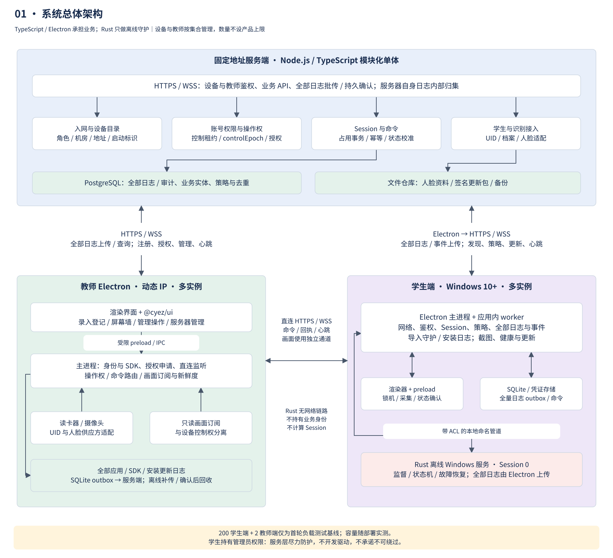
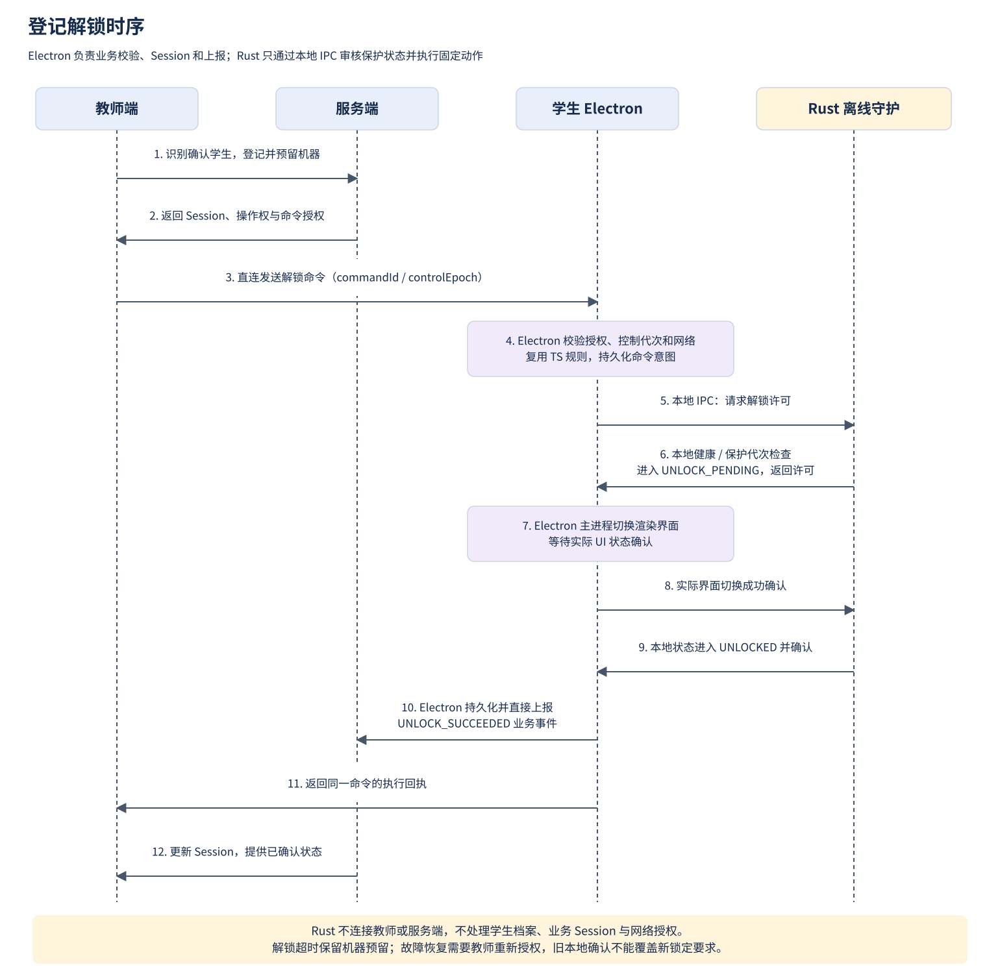
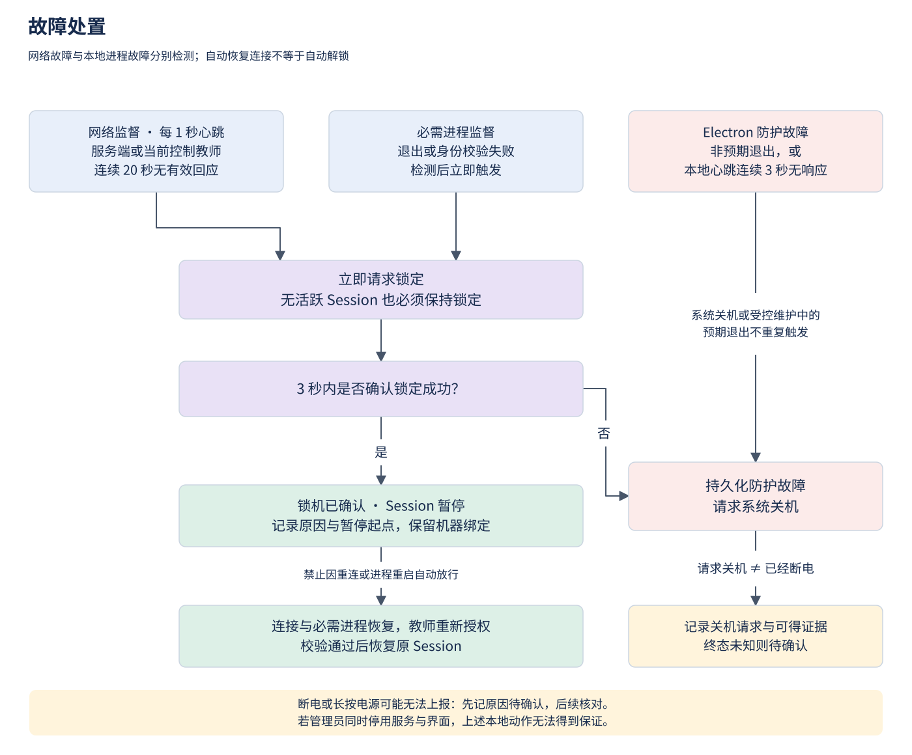

# 学校图书馆机房管理系统架构设计

设计基线：2026-10-22。状态：设计已整理，业务代码尚未实现。本次修订将学生端主要逻辑移入 Electron，Rust 收窄为离线守护进程，明确 TypeScript / Yarn workspaces 工程组织，并将设备数量改为负载测试基线。本文件是行为与接口约定的主要依据；图片与可编辑图应随本文件同步更新。

## 目标、约束与范围

系统服务于多个机房，不对学生端、教师端或机房数量设置产品上限。首轮负载测试使用 200 台学生机和 2 个教师端；该规模不是许可限制、协议限制或写死的数组大小，也不意味着单节点有无限容量。实际容量受硬件、数据库、网络和画面订阅量影响，扩容前按目标负载验证。服务端 IP 固定，教师端 IP 可以变化，学生端启动时从服务端发现当前控制教师。

- 学生机仅假定运行 Windows 10 或更高版本，不依赖特定版本类型的专属能力。具体 Windows 构建、架构、Electron 支持范围、显卡和读卡器列入部署兼容性测试；不将“Windows 10+”等同于所有旧构建均已兼容。
- 学生持有管理员权限；仅实现 Rust 服务层的尽力防护，不开发驱动，不承诺管理员无法绕过。
- 学生端主要逻辑位于 Electron 应用内，服务端和两类 Electron 客户端统一使用 TypeScript，通过现代 Yarn workspaces 复用代码；Rust 仅执行固定的离线守护功能与本地状态机。
- 网络心跳每 1 秒一次，连续 20 秒未收到有效回应即收回使用权限。必需进程退出即锁机。
- 首版包括录入、识别接入、分配机器、Session、屏幕墙、管理命令、活动日志、服务器管理及自动更新。
- 人脸算法、摄像头 SDK、读卡器 SDK 和具体 UI 库不在本次实现范围；定义接口，后续接入。首版不含远程键鼠控制、视频录像和高可用集群。

## 总体架构与职责



[可编辑源文件](architecture.drawio)包含“总体架构”“登记解锁时序”“故障处置”三个页面。服务端是业务状态和授权的中心；教师与学生直连承载命令和画面，学生日志直接上报服务端。

### 服务端

采用 Node.js / TypeScript 模块化单体服务、PostgreSQL 和独立更新包文件仓库。接口使用 HTTPS/WSS；与 Electron 共用工作区中的协议、运行时校验及纯业务规则。服务端框架后续选定，语言和代码复用方向已确定。

| 模块 | 职责 |
| --- | --- |
| 设备注册与目录 | 入网审批、设备凭证、角色、机房、版本、启动报告、当前地址、教师发现 |
| 权限与控制权 | 教师账号权限、设备角色、机房授权、单机操作权、控制代次与命令授权 |
| 学生与人脸资料 | 学生档案、卡 UID、换卡记录、人脸资料及算法版本 |
| Session | 登记、机器预留、解锁确认、暂停区间、结束与待核实事项 |
| 状态与日志 | 接收学生事件、去重、状态投影、历史查询、人工更正审计 |
| 策略与版本 | 必需进程策略、签名更新清单、安装包、升级状态与回滚信息 |
| 运行管理 | 运行状态、备份恢复、容量、告警、证书和凭证生命周期 |

首轮在单节点上验证 200 个学生连接、2 个教师连接；设备目录、机房分组和教师授权按集合与分页处理，不硬编码数量。心跳状态在内存维护，只将状态转换和必要快照持久化。服务端重启后将连接状态视为待确认，重新建立连接并校准，不沿用过期的“在线”状态。更大负载需实测与容量规划；后续多节点部署必须补充共享操作权和连接路由，不能直接把单节点内存状态横向复制。

服务器是首版的单点依赖：其故障持续 20 秒会使学生端锁机。维护计划必须与实际使用协调，不能在监控中将这种锁机误认为学生违规。

### 教师端

Electron 主进程负责网络、设备凭证、硬件适配和直连监听；渲染进程只通过收窄的 IPC 接口调用这些能力，不获得任意系统命令、文件读写或数据库权限。

| 界面 | 功能 |
| --- | --- |
| 录入与登记 | 读取饭卡 UID、人工录入姓名等资料、采集与绑定人脸、日常识别、待分配队列 |
| 监控与操作 | 机房筛选、屏幕墙、单机放大、学生与 Session 状态、锁定/解锁、结束使用、关机、异常原因 |
| 服务器管理 | 设备审批、账号与机房授权、必需进程策略、版本发布、日志、运行状态、备份恢复 |

服务器管理操作由服务端重新鉴权，并写入审计日志。教师设备身份不自动赋予所有服务器管理权限。UI 通过组件适配层组织，具体组件库后续选定。

### 学生端

- **Electron 主进程及应用内工作进程（TypeScript）**：持有设备网络身份，负责注册与教师发现、全部 HTTPS/WSS 连接、网络心跳、命令授权与幂等校验、Session 本地业务状态、策略同步、日志补报、画面传输和更新协调。复用服务端与教师端的共享包，计算或存储重任务从主事件循环隔离。
- **Electron 渲染进程**：显示锁机界面、参与屏幕采集并确认实际界面状态，通过受限 preload 与主进程通信；不直接访问设备私钥、数据库和守护 IPC。解锁时隐藏锁机窗口而不是结束应用，以便持续监督。
- **Rust 离线 Windows 服务**：开机启动，管理交互式会话中的 Electron 生命周期，监督 Electron 和必需进程，通过本地状态机约束锁定/解锁切换、超时及受控维护，执行固定的关机等系统动作，记录本地守护事实。没有 HTTP/WSS 客户端或远程监听，不负责注册、教师发现、业务命令鉴权、Session 计算、日志网络上报、截图或更新下载。
- **Electron 管理的本地 SQLite**：保存待发送业务事件、已处理命令和恢复所需状态，由应用的单一存储模块写入；Rust 使用独立的本地守护日志，不并发写业务数据库。设备凭证及更新信任材料单独保护，更新不能重新生成设备身份。

Windows 服务运行在 Session 0，不能直接承担用户桌面界面。服务管理当前交互式用户会话中的 Electron，并通过带 ACL 的命名管道通信；管道绑定会话及子进程身份，不以进程名或客户端自报身份建立信任。Electron 不因有守护服务而以 SYSTEM 身份运行；设备通信与业务权限留在 Electron 主进程，SYSTEM 仅承担所需的本地系统动作。

守护服务跟随用户登录、注销管理应用生命周期，Electron 跟随显示器变化管理覆盖窗口；开机、登录和重启后默认锁定。会话切换、远程登录及多显示器必须验证，不能让新会话因缺少覆盖窗口获得未授权使用。

### TypeScript 与现代 Yarn workspaces

采用 Yarn 4.x（现代 Yarn，非 Yarn Classic）monorepo。以下为待编码时落地的工程约定，本次只更新文档和图，不创建空应用或声称工程已经实现。

```text
apps/
  server/                 # @cyez/server：Node.js / TypeScript 服务端
  teacher/                # @cyez/teacher：Electron 教师端
  student/                # @cyez/student：Electron 学生端主要逻辑与界面
packages/
  protocol/               # @cyez/protocol：网络消息、DTO、运行时校验
  domain/                 # @cyez/domain：纯业务规则与 Session 转换规则
  client-sdk/             # @cyez/client-sdk：HTTPS/WSS、认证封装、重连与去重工具
  guardian-contract/      # @cyez/guardian-contract：版本化本地 IPC schema / 测试向量
  ui/                     # @cyez/ui：教师端和学生端的 UI 适配与共享组件
native/
  guardian/               # Rust Cargo crate：离线守护进程
```

根 `package.json` 使用如下配置；`4.18.1` 是本次修订核对的 Yarn 4.x 版本示例，实施时经兼容性验证后固定精确版本，不使用浮动的 `latest`：

```json
{
  "name": "cyez-library-management",
  "private": true,
  "packageManager": "yarn@4.18.1",
  "workspaces": ["apps/*", "packages/*"],
  "scripts": {
    "build": "yarn workspaces foreach -A --exclude cyez-library-management --topological run build",
    "typecheck": "yarn workspaces foreach -A --exclude cyez-library-management run typecheck",
    "test": "yarn workspaces foreach -A --exclude cyez-library-management run test"
  }
}
```

内部依赖明确声明，如 `"@cyez/protocol": "workspace:^"`，不使用相对目录跨包导入或复制代码。根脚本遍历工作区时排除根包，避免再次执行自身产生递归。根目录维护单一 `yarn.lock`，CI 使用 `yarn install --immutable`；构建工具环境按 `packageManager` 配置 Yarn，CI 显式准备 Corepack 或等效的版本化 Yarn 启动器，不假定 Node.js 自带它。

`.yarnrc.yml` 选择 `nodeLinker: node-modules`，便于 Electron 打包与原生模块重建；这是现代 Yarn 的受支持链接模式，仍使用 Yarn 4 的 workspaces 与 `workspace:` 机制，不退回 Yarn Classic。各工作区通过包导出边界引用编译产物，按依赖顺序构建，部署只携带目标应用及其运行时依赖。

`protocol`、`domain` 不依赖 Electron、数据库或 Node.js 特定 I/O，供服务端和客户端共同使用；共享校验只复用规则，最终权限和占用事务仍由服务端执行。`client-sdk` 放在 Electron 主进程或应用内工作进程使用，`ui` 只负责界面，服务端不引用它。

Rust 由 Cargo 构建，不伪装成 JavaScript workspace；应用构建编排调用 Cargo 并将守护二进制装入安装包。Rust 只共享本地 IPC 的版本化 schema 和序列化测试向量，不导入 TypeScript 业务包；双方结构通过 schema 生成或校验保持一致，避免再用 Rust 重写 Session 和网络协议逻辑。

### Rust 离线守护状态机与本地接口

Rust 的“离线”指不参与任何远程通信，并非只在断网时运行。Electron 调用有限的本地接口：握手/心跳、读取状态、应用必需进程配置、请求/确认解锁、请求/确认锁定、请求关机、受控维护、读取/确认守护事件；禁止任意 shell、任意路径执行和任意文件操作。

| 本地状态 | 进入条件与动作 |
| --- | --- |
| `STARTING` | 当前用户会话启动 Electron，等待 IPC 与首次锁定确认；启动就绪期限默认 30 秒，超时请求关机；没有交互式用户时不运行该期限 |
| `LOCKED` | 界面已确认锁定；保持进程监督，不因进程重启或网络恢复自动解锁 |
| `UNLOCK_PENDING` | Electron 已完成业务鉴权并提出请求；Rust 检查本地健康及锁定代次，批准一次界面切换，3 秒内等待实际解锁确认；失败回到锁定流程 |
| `UNLOCKED` | 界面切换已确认，本地监督正常；没有学生资料或 Session 业务状态 |
| `LOCKING` | 网络期限届满、必需进程退出或 Electron 请求锁定；发送锁定要求，3 秒内未确认则请求关机 |
| `MAINTENANCE` | 经受控安装/维护流程进入，限定对象和期限；退出时重新进入默认锁定流程；豁免到期按当前进程与界面实际健康处置 |
| `SHUTTING_DOWN` | 关机前写本地守护事件并执行系统动作，避免将预期进程退出再次当作故障 |

`UNLOCKED` 等表示本机保护状态，不能替代服务端 Session 状态。Electron 保存并校验 Session、`controlEpoch`、业务命令和签名；Rust 仅维护本地保护代次、请求序号和有限结果，防止旧 IPC 解锁或确认覆盖新锁定要求。故障、重新登录及守护重启使旧解锁请求失效。Rust 进入 `SHUTTING_DOWN` 后不再接受解锁。

网络心跳及失联判断由 Electron 实现。为让守护状态机具有独立的本地超时，Electron 在每次有效远端 ack 后分别报告服务器、控制教师两个通路的健康序号及剩余有效期（最多 20 秒）；Rust 只维护本地单调时钟截止时间，不发网络包、不验证远端协议或处理教师身份。传输延迟从剩余有效期扣除，重复健康序号、普通 IPC 心跳及地址重试不能延长截止时间。任一期限届满，Rust 可独立进入锁定流程；Electron 也会主动请求锁机。

本地每秒心跳必须反映 Electron 主逻辑和锁机渲染进程的有效响应，不能由独立定时器在界面卡死时继续报“健康”。主进程非预期退出、受监督渲染进程故障或连续 3 秒无有效健康回应时，Rust 离线记录并请求关机。它信任受约束的本地 Electron 报告，不具备证明远端连接真实健康的能力，不能据此宣称可抵抗管理员篡改 Electron。

守护日志只包含本地事件标识、启动/会话标识、原因和可选的不透明关联标识，不计算学生使用时长。Electron 拉取事件，持久化到自己的待发送队列后再确认本地接收，Rust 方可回收记录；事件由 Electron 统一上报、服务端去重。应用已退出而无法上报时，守护事件留待下次启动补报；记录故障不能阻塞关机动作。

## 设备身份、注册与发现

### 身份模型

设备身份由稳定的 `deviceId`、设备证书和角色组成；每次开机生成 `bootId` 区分跨启动事件。教师登录账号独立于教师设备身份。IP 仅是路由信息，不能用来判断设备身份或角色。

首次入网使用由管理端发放、绑定角色和机房的一次性注册码，或先进入待审批状态。服务端批准后签发设备凭证；后续启动仅报告和验证身份，不重新自行选择角色。角色变更、吊销及重新入网都留审计记录。

连接采用 TLS，设备接口使用双向设备认证，教师业务接口额外检查登录账号权限。安装配置预置服务端地址及信任根，不能接受任意广播地址或跳过证书校验。私钥的本机保护属于尽力防护，不能保证对本地管理员保密。

### 启动和地址更新

1. Rust 在本地启动和监督学生 Electron；学生及教师 Electron 主进程使用安装配置连接固定服务端地址，验证服务器身份。Rust 不连接网络。
2. 报告 `deviceId`、`bootId`、角色、版本、机房和可达端点，服务端返回策略、协议兼容信息及注册结果。
3. 教师端绑定 LAN 接口并报告其直连地址和端口；网络接口变化时重新注册，服务器同时记录请求来源供核对，不假定多网卡上所有地址都可达。
4. 学生端查询当前控制教师的设备标识、端点、证书身份、控制代次和有效期，再主动连接教师端的 WSS 接口。
5. 教师地址变化或直连失败时，学生重新查询目录并重连。重试、获取目录或建立 TCP 连接不能代替有效应用层心跳。

学生端不依赖广播寻找服务器；固定地址由安装配置提供。跨机房需允许学生到服务器以及学生到教师指定端口的连接；服务器目录解决寻址，不能穿透网络隔离。发现条目过期、身份不匹配或无控制教师时保持锁定。

## 通信协议与接口边界

### 三条通信路径

| 路径 | 传递内容 | 约束 |
| --- | --- | --- |
| 教师 ↔ 服务端 | 录入、识别结果、状态查询、日志查询、Session、操作权、命令授权、管理、心跳 | 业务状态由服务端保存与鉴权 |
| 学生 Electron ↔ 服务端 | 启动报告、教师发现、策略、心跳、学生事件、命令结果、更新 | Electron 直接上报业务和导入的守护事件，不依赖教师转交 |
| 学生 Electron ↔ 教师 | 管理命令、执行回执、心跳、屏幕缩略图 | Electron 主动建立双向连接；控制与画面使用独立通道 |

API 使用 `/api/v1` 前缀的 HTTPS JSON；WSS 在 HTTP 升级连接后使用版本化消息。心跳为带序号的应用层 ping/ack，校验会话和序号，旧回应不能反复续期。命令和事件均使用有限大小消息与限长队列。

| 接口组 | 主要操作 |
| --- | --- |
| `devices` / `discovery` | 入网、启动报告、地址更新、状态、当前控制教师查询 |
| `students` / `face` | 学生资料、UID 绑定与换卡、人脸登记与识别适配 |
| `sessions` | 登记、预留机器、申请解锁、暂停、恢复、结束 |
| `control` / `commands` | 申请或转移操作权、授权命令、结果确认和查询 |
| `events` | 批量上报、持久化确认、查询和审计更正 |
| `policies` / `updates` | 必需进程策略、版本清单、安装包、升级结果 |

消息至少携带协议版本、请求或事件标识、设备和启动标识。学生自己的事件上报只能影响自己的设备状态；日志中不接收客户端自报的教师权限。

### 多教师操作权与命令一致性

多名教师可查看各自获授权的设备，同一学生机仅有一名控制教师；教师总数不固定为两名。服务器事务性分配控制权，发放可续期的租约及单调递增的 `controlEpoch`。接管更新代次，并将最新代次推送至学生 Electron。

命令授权包含 `commandId`、动作、目标设备、`sessionId`、控制教师身份、`controlEpoch`、有效期和服务端签名。学生 Electron 同时验证教师连接身份、授权、当前 Session 和代次，并将需要的固定本地动作交给 Rust；Rust 不重做远程业务鉴权。相同 `commandId` 返回 Electron 已记录的结果，不能重复执行。

接管只有在学生确认最新代次并建立新教师连接后才算完成；旧代次一旦安装到学生端即被拒绝。服务器离线、学生无法同步新代次时，不把接管显示为成功，也不能仅凭服务器数据库更新就声称旧通道已失效。接管过程不消除连续失联期限。

教师点击操作、服务端授权、学生接收、学生执行是不同阶段。超时表示结果待确认，不等同于操作失败或成功；教师查询同一命令标识解决不确定结果。服务器失联时不能发起新的解锁；学生仍可本地执行故障锁定和关机。

## 学生资料与人脸接入

首次登记时读取饭卡 UID，不解密卡内容。UID 按字节顺序、长度保存，展示使用统一十六进制形式；不把不同长度或去掉前导零后的值混为同一张卡。读卡器适配器必须验证实际卡片是否提供稳定 UID。

系统生成独立的 `studentId`，姓名、班级等人工录入。一个有效 UID 只能绑定一个学生；学生换卡时撤销旧绑定并新增绑定记录，保持 Session 历史不变。UID 是卡凭证，不是不可复制的密码，不作为远程设备或教师身份认证材料。

人脸适配接口提供登记、识别、删除和算法版本查询。识别返回候选学生、置信信息及识别状态，业务层决定是否接受；失败或多候选不能自动解锁。教师可以对识别问题作人工核验，任何人工代登记必须单独授权并审计。

服务端集中保存人脸模板或供应方资料引用、格式和算法版本；若算法需要原始图像，另行明确保留与删除策略。学生端不保存全校人脸库。敏感资料加密存储、限制导出，并记录访问；日志不写入完整模板、原始图像或设备私钥。

## Session 与登记解锁流程



1. 教师录入完成首次档案，或通过人脸识别确认已有学生，创建待分配 Session。
2. 教师指定机器，服务端事务性检查学生和设备均无冲突，预留机器并记录待解锁命令。
3. 教师获得控制权和命令授权后，经直连向学生 Electron 主进程发送解锁命令。
4. Electron 使用共享协议和业务规则验证授权、当前控制代次及两条网络连接，持久化命令意图，并向 Rust 请求本地解锁许可。Rust 只检查必需进程、本地健康与保护代次，进入 `UNLOCK_PENDING`；Electron 收到许可后切换渲染界面，并将实际状态确认回 Rust。
5. Rust 确认本地状态为 `UNLOCKED` 后，Electron 持久化 `UNLOCK_SUCCEEDED` 事件，直接上报服务端并返回教师回执。服务端依据学生事件确认使用开始；只有 Rust 许可或只有教师回执均不等于使用已确认开始。
6. 网络或必需进程故障时锁机并暂停；恢复后由教师针对同一 Session 发放新的恢复授权。
7. 正常结束、关机、教师强制结束时关闭 Session；未收到确定证据时进入待确认状态。

### 状态与计时

| 状态 | 含义及下一步 |
| --- | --- |
| `REGISTERED` | 已确认学生，等待机器分配；可取消 |
| `UNLOCK_PENDING` | 已预留机器且命令待执行；重复请求复用同一命令 |
| `ACTIVE` | 学生端确认解锁，累计实际使用时间 |
| `PAUSED` | 锁机已确认，保留学生和机器绑定；教师重新授权才恢复 |
| `END_PENDING` | 已请求结束或失联，终态证据尚不足 |
| `ENDED` | 已确认结束；保存正常、异常或无法确认的原因及证据等级 |
| `CANCELLED` | 尚未实际开始使用的登记被取消 |

同一学生及设备最多对应一个未结束的使用 Session，预留、暂停和结束待确认均算占用。暂停不自动释放座位；教师可以显式结束。待解锁命令超时也不能立即释放预留，必须通过学生状态校准或审计处置排除“已解锁但回执丢失”。

登记总时长从登记到最终结束，实际可用时长累加已确认解锁区间，排除暂停。学生端使用单调时钟记录同次启动内的区间，记录 UTC 时间用于展示；服务端保留接收时间，不能仅依赖可能被学生修改的本地系统时间。

网络失联时，服务器只能确认通信中断，不能声称锁机已经执行；状态显示“失联／锁机待确认”。补报后再修正实际使用区间，保留修正依据。骤然断电且无终态证据时，记录最后确认时间与可能结束区间，不伪造精确结束秒数。

## 故障处置与关机证据



### 检测参数与动作

| 监督项 | 参数 | 故障动作 |
| --- | --- | --- |
| 学生 Electron ↔ 服务端 | 每 1 秒网络心跳，自最后有效回应起连续 20 秒 | Electron 请求锁机；Rust 本地健康期限同时兜底，有 Session 则由 Electron 记录暂停 |
| 学生 Electron ↔ 当前控制教师 | 每 1 秒网络心跳，自最后有效回应起连续 20 秒 | Electron 请求锁机；Rust 本地健康期限同时兜底，有 Session 则由 Electron 记录暂停 |
| 教师 ↔ 服务端 | 每 1 秒心跳，20 秒失联 | 撤去新操作入口，显示状态失效，重连后校准 |
| Rust ↔ Electron | 每 1 秒本地心跳，已就绪后连续 3 秒无有效响应；非预期退出立即检测 | Rust 本地记录防护故障并请求关机；启动就绪期限见本地状态机 |
| 必需进程 | Rust 订阅进程退出信号，并周期性核对身份与实例 | 通过本地 IPC 要求 Electron 锁机；初次解锁前缺失则拒绝本地许可 |
| 锁定执行 | Rust 发出锁定要求后 3 秒内未收到 Electron 界面确认 | Rust 本地记录锁定失败并请求关机 |

Electron 分别维护服务端和教师端的网络计时，Rust 只维护对应的本地健康截止时间，任一路达到 20 秒都触发锁定，不以另一条通路仍在线抵消。网络抖动小于阈值时不因该条网络判定锁机，但在通信不健康时禁止新解锁。检测计时使用单调时钟，普通本地心跳不能刷新网络健康期限。

无活跃 Session 的学生机同样保持锁定。网络恢复、进程重新出现或软件重启均不自动解锁。恢复必须满足两条连接健康、必需进程就绪、界面正常、授权有效。

进程名单表示“必须存活”，不是“只允许这些软件运行”。配置包含规范化绝对路径、适用用户会话、所需实例数，以及可用的签名或文件摘要。监测时绑定进程句柄和创建时间，防止同名进程或 PID 复用被当作原进程；进程存活不代表其业务功能一定健康。

启动期间先进入锁定，待全部必需进程就绪再允许解锁；受控维护期间预期退出不触发正常运行期的故障动作。不能以一个无期限本地标志关闭防护。

### 日志分类

| 事实 | 分类方式 |
| --- | --- |
| 学生正常结束后由软件请求关机 | 正常结束；分别记录结束、关机请求及可观测的系统关机事件 |
| 可观测的学生发起 Windows 正常关机 | 正常关机意图；最终是否完成仍按可得证据记录 |
| 教师因异常使用强制关机 | 异常结束，关联教师账号、填写原因、命令和学生执行证据 |
| Electron 非预期退出、无响应或锁定失败 | 防护故障导致的异常结束，不直接宣称“恶意杀进程” |
| 突然断电、长按电源、系统崩溃且无上报 | 原因待确认；下次开机及人工核对后追加结论 |

学生用完后长按电源可在核实后按正常使用结束处理；Windows 的非正常关机证据本身不能证明操作者、动机，也不能把所有突然离线都记为正常。

区分 `SHUTDOWN_REQUESTED`、`OS_SHUTDOWN_OBSERVED`、`DEVICE_OFFLINE` 和最终 Session 结论。请求关机成功不等于机器已断电；关机失败另记事件并保持可用的锁定措施。系统正在关机时，Electron 的预期退出不再重复触发防护关机。

### 故障监督与自我保护边界

Rust 离线服务采用 Windows 服务自动启动、故障恢复及最小必要权限。程序目录、服务配置、本地数据和 IPC 进行 ACL 收紧；服务不暴露远程接口、任意 shell、任意进程终止或任意文件修改接口。Electron 校验远程操作后，仅调用固定的本地动作枚举。

Rust 监督循环只有本地进程、计时、IPC 与最小日志 I/O，不包含网络、屏幕压缩或更新下载。Electron 内部将网络、日志、屏幕压缩和更新任务隔离，使用超时与限长队列；不能通过盲发本地心跳掩盖业务循环或渲染器卡死。异常处理不能让日志发送阻塞锁机；Rust 内存安全并不能替代死锁、磁盘故障和系统资源耗尽测试。

Electron 使用上下文隔离和受限 preload，不加载不受信任的远程页面；锁机时覆盖各显示器，拦截可拦截的退出及切换操作。若其检测到 Rust 失联，先本地显示锁机界面；服务恢复后重新校准状态。

**这些措施不构成对本地管理员的强安全边界。** 管理员可以绕过 ACL、停用恢复机制、修改文件或同时结束服务与界面。服务一旦不能执行，便无法保证继续锁机、记录事件或关机。普通键盘钩子不能完整拦截 Windows 安全注意序列及安全桌面。不得将进程互相拉起、SYSTEM 身份或全屏窗口描述为“不可退出”。

## 屏幕墙、日志与数据持久化

### 屏幕墙

每个教师端默认可见页订阅预算为 60 个缩略图、约 1 帧/秒，可按实测配置；这是界面分页与带宽策略，不是可注册或可管理学生机数量上限。切换分页取消不可见订阅。单机放大使用更高分辨率的低帧率画面，首版不是实时视频和远程控制。

屏幕采集和压缩在 Electron 应用内执行，由 Electron 主进程或工作进程发送，画面不经过 Rust。画面和命令采用独立网络通道，慢消费者只保留最新帧。截图失败显示“画面不可用”和最后更新时间，不能继续显示旧图而伪装为实时画面。安全桌面、受保护内容和 GPU 差异可能导致采集失败，应作为独立状态展示。

查看画面与操作机器是不同权限；只读教师可以申请短期画面订阅凭据，但不获得操作权，也不参与学生对当前控制教师的心跳判定。默认不保存截图历史。

作为首轮负载测试的流量预算，若每张缩略图平均 50 KB，则 60 台 × 1 帧/秒约 3 MB/s／教师端；测试中的两端分别订阅时约 6 MB/s。教师数量和可见订阅数增加时相应计算总流量。这是容量估算而非测量结果，最终以分辨率、内容、压缩和 LAN 实测调整。

### 事件和数据模型

主要数据实体为设备、教师账号与机房授权、控制租约、学生、卡绑定、人脸资料、Session、使用区间、命令、事件、策略版本和更新版本。PostgreSQL 事务及唯一约束维护学生/机器占用、有效 UID 和命令事件幂等性。

事件至少包含 `eventId`、`deviceId`、`bootId`、设备内序号、`sessionId`（可空）、`commandId`（可空）、类型、发生时间、接收时间、原因和证据。服务端按事件标识去重，按启动序号和状态机处理乱序；晚到事件不覆盖新 Session 的状态。

Electron 将关键事件先写入自己管理的 SQLite 待发送队列，再通过共享客户端 SDK 上报。Rust 的本地守护事件由 Electron 导入，保留原事件标识、原因、启动标识和观测时间，不用补报时间伪造故障时间。服务端在事务提交后确认接收，Electron 收到确认才回收队列记录。关机前 Electron 尽力发送且有超时；应用已退出时 Rust 只写本地守护日志，待下次启动由 Electron 补报。网络日志、版本日志和业务审计分层保存，不将每个心跳都作为活动日志。

磁盘空间不足时限制普通诊断日志，优先保留业务和故障事件；关键事件无法落盘则停止新解锁并锁定活跃使用，显示或上报存储故障。无法写盘时不得承诺日志仍可靠。服务端数据库不可写时拒绝需要持久化的授权请求，客户端保留未确认事件重试。

人工更正追加审计记录，保留原事件、操作者和理由；正常查询不得直接删除或覆盖原始事实。日志留存与人脸资料保留期由学校配置，首次启用清理前必须确认策略，不设置未经确认的自动清空行为。

## 自动更新、维护与备份

客户端 Electron 启动后自动检查签名版本清单，负责版本选择、下载、校验和更新协调；Rust 不联网检查或下载更新。清单包含目标组件、平台、版本、包摘要、最低网络协议、本地守护 IPC 版本及系统要求；下载支持断点续传，安装前验证清单签名与包摘要。服务器管理权限和更新签名私钥分离，不能仅靠 TLS 或摘要认定包来源可信。

下载可以后台进行，安装切换必须进入受控维护状态：学生端无活跃 Session、用户已注销；教师端不再承担活动学生机的控制任务，必要时先完成转交。维护期间拒绝新解锁，限制预期退出豁免的对象和期限，不能因普通程序崩溃自动进入维护。

Electron 在注销前完成包暂存和更新计划，交由独立、受限的本地更新执行器在注销后完成服务退出、文件切换和重启，不让运行中的守护服务自行选择版本或覆盖自身。执行器验证暂存包与计划，只执行限定的安装操作；Rust 仅配合有期限的维护状态。保留上一已验证版本，健康检查失败回滚；本地数据迁移必须兼容回滚或配套恢复备份。恢复为旧版也不能清空身份、Session 待确认状态、未上报事件或未被 Electron 接收的守护日志。

启动后先锁定，由 Electron 报告新版本并校准状态，再开放登记操作。网络协议或 Electron/Rust IPC 版本不兼容时保持锁定并给出明确错误，不能降级到无认证通信或绕过守护。

备份覆盖 PostgreSQL、人脸资料、设备信任材料、策略和必要配置，私钥备份独立加密。恢复演练验证档案、Session、凭证及日志关联；不能只验证备份文件存在。服务器恢复旧备份后需重新校准设备启动标识、状态和未确认事件，防止误发旧授权。

## 验收与后续实施

本次交付为文档、三页可编辑图及对应图片。设计阶段验证链接、图源格式、图片渲染及图文一致性；以下为实现阶段验收，不代表已通过。

| 类别 | 关键场景与通过条件 |
| --- | --- |
| 平台与锁机 | Windows 10/11 实机、多显示器、登录注销、会话切换；默认锁定，准确记录无法防护的系统入口 |
| 入网与发现 | 未审批设备不能提权；教师 IP 改变后按身份重连；错误证书和过期目录被拒绝 |
| 登记闭环 | UID 冲突、换卡、人脸失败/多候选、学生或机器重复分配；仅学生解锁事件确认开始 |
| 多教师并发 | 基线使用 2 个教师端竞争同机，另增加教师验证无固定数量限制；接管中断、旧代次、过期与重复命令不会双重占用或重复执行 |
| 网络监督 | 分别断服务器、控制教师和两者连接；验证自最后有效回应起 20 秒锁机，恢复后不自动解锁 |
| 进程监督 | 必需进程退出、同名替换、PID 复用、Electron 无响应、维护期预期退出；动作与原因匹配 |
| 离线守护 | Rust 不产生远程连接；Electron 退出或不响应时独立执行本地故障动作；普通 IPC 心跳及重复健康序号不能续期网络健康期限 |
| 本地状态机 | 启动期限、解锁与故障锁定竞争、过期 IPC、渲染器卡死、守护重启、维护超时；旧确认不能覆盖新锁定要求 |
| 工作区复用 | Yarn 4 固定版本、不可变安装、内部 `workspace:` 依赖、共享规则通过各端用例；Cargo 单独构建，本地 IPC 序列化向量在 TS/Rust 两端一致 |
| 关机与证据 | 正常关机、教师强制关机、系统崩溃、长按电源和断电；不把未知原因伪装成确认事实 |
| 恢复与存储 | 重复/乱序补报、服务器重启、磁盘满、断电中断写入；不丢失已确认事件或污染新 Session |
| 更新与备份 | 签名错误、损坏包、不兼容版本、升级断电、回滚、身份及日志保留、恢复校准 |
| 负载基线与扩展 | 首轮使用 200 学生端和 2 教师端，各订阅 60 缩略图；画面负载不得造成持续心跳超时或阻塞锁机。额外注册第 201 个学生端、第 3 个教师端验证无硬编码上限，更大规模另行压测 |

实施顺序：先建立 TypeScript / Yarn workspaces 共享契约与离线守护 IPC，完成 Electron 锁机及 Rust 状态机原型，实测管理员权限下的边界；再在 Electron 内完成注册—登记—解锁—日志最小闭环；最后加入屏幕墙、更新和可调整的负载验证。不得以正常功能测试代替管理员对抗能力验证。

## 设计依据与后续选型

- Microsoft：[Interactive Services](https://learn.microsoft.com/en-us/windows/win32/services/interactive-services)，说明 Session 0 隔离、用户会话进程和 IPC 的职责分离。
- Microsoft：[Protecting anti-malware services](https://learn.microsoft.com/en-us/windows/win32/services/protecting-anti-malware-services-)，说明受保护服务的特定前提；普通 Rust 服务不能直接获得相同保证。
- Microsoft：[Keyboard Filter](https://learn.microsoft.com/en-us/windows/configuration/keyboard-filter/)，支持范围并非所有 Windows 版本类型；本设计不依赖该能力。
- Yarn：[Workspaces](https://yarnpkg.com/features/workspaces)，工作区声明、`workspace:` 内部依赖与按工作区构建部署。
- Yarn：[配置参考](https://yarnpkg.com/configuration/yarnrc#nodeLinker)，现代 Yarn 支持 `node-modules` 链接模式。

后续编码前需选定服务器框架、UI 库、读卡器/摄像头 SDK、人脸供应方和支持的具体 Windows 构建。这些选型须满足本文接口与行为约定；不以选型未定为由改变已确认的心跳、故障和 Session 规则。
