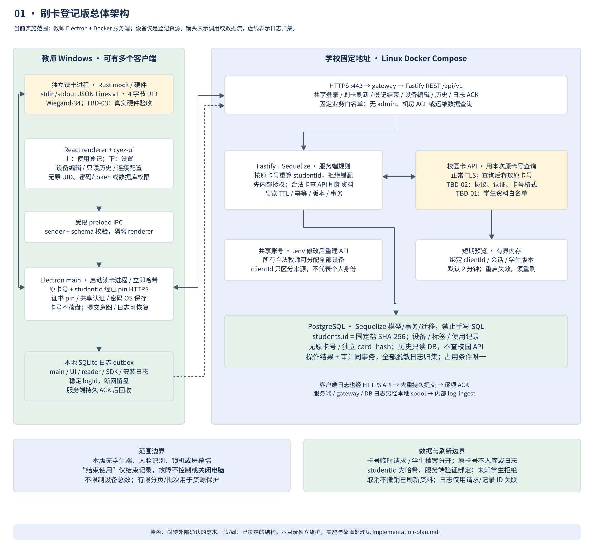

# 刷卡登记版：正式设计入口

修订日期：2026-10-29。依据原[草图](docs/draft/draft.drawio)及最新提交 `a18466c` 中的 [opinions.md](opinions.md) 修订，意见文件优先。当前交付是规格、技术决策、测试计划与可编辑图册，尚未实现应用，也未运行产品单元测试、集成测试或 Docker 部署。

本阶段仅由教师 Electron 客户端、Docker 化 Node.js 服务端和 PostgreSQL 组成。教师端接收 USB 刷卡与人工操作；服务端决定身份、登记、占用、结束和批量修改。设备是被登记使用的资源，本阶段没有学生客户端、锁机、截图、人脸识别或 Rust 服务。原有[三端完整方案](../docs/architecture.md)作为后续扩展设计保留，其 Session、防护和直连规则不能套到本阶段。

| 正式文档 | 内容 |
| --- | --- |
| [需求与业务规格](docs/specification.md) | 范围、登记/结束流程、数据字典、事务、业务 API、异常与日志 |
| [决策、依据与待定项](docs/decisions.md) | 草图逐项追踪；已决定的问题及来源；待定需求与上线影响 |
| [Docker 部署设计](docs/deployment.md) | 五类服务、网络/卷、.env 共享口令、证书指纹、ORM 迁移、健康与验收 |
| [测试设计](docs/testing.md) | 服务端与客户端分别覆盖单元/集成；真实 PostgreSQL、真实 Electron、CI 门禁 |
| [UI 与 cyez-ui 接入](docs/ui.md) | 登记/设置两个入口、设备编辑、只读历史、10 秒空闲取消、包入口与 Yarn 消费 |
| [正式图册](docs/diagrams.md) | 八张详细 SVG 和统一可编辑 draw.io；黄色标出待定项 |

服务端采用 **Fastify + Sequelize + PostgreSQL**，通过库 API 查询和迁移，不手写 SQL；客户端采用 **Electron + React + cyez-ui**；工程使用 **Yarn 4 workspaces**。UI 实际包名为 `@series/ui` 和 `@series/electron`，使用授权已由用户确认。

所有教师共用一个业务账号，可分配所有设备，无 admin/机房权限。设置页配置 IP、叶证书 SHA-256 指纹和账号密码，应用内固定证书，不安装系统自签名证书；服务端在 `.env` 修改密码后重建 API。

读卡模块立即固定盐哈希；内部数据库不存在的学生拒绝登记。每次有效刷卡向校园 API 获取最新资料并更新已有档案，历史只查内部库且不可编辑/删除。登记为连续 10 秒无操作取消，刷卡结束仍为 5 秒确认。设置提供设备添加/编辑/软删除与只读历史列表，无备份/导出功能。

待定项在图中标黄：学生字段、API/读卡协议、部署和发布输入，以及新增的初始合法学生预置来源 TBD-07。TBD-02 特别要求确认 API 能否使用 cardHash 或预置的非原卡号查询标识；不假定哈希能还原成卡号。跨卡身份迁移 NEXT-01 仍延期，新卡无预置记录即拒绝。
