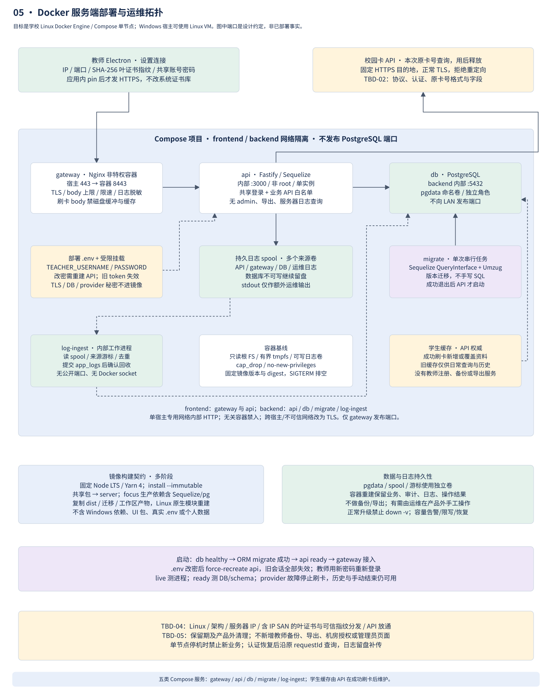

# Docker 部署与运维设计

2026-10-31 修订：本地学生表仅缓存校园 API 成功返回的资料，不再承担登记授权或要求生产预置。服务运行账号新增 `students` 的受限 `INSERT` 权限；迁移 `002-student-cache` 使旧的预置字段可空，保留历史记录和缓存资料。迁移作业同时写入固定盐等身份配置的指纹；API 在指纹缺失或不匹配时拒绝启动。服务先查询 API，成功后新增或覆盖缓存；旧缓存只供日常列表和历史读取，故障刷卡不放行。下文预置与 TBD-07 旧规则已撤回，真实 API 拒绝语义归 TBD-02。

2026-10-29 修订，依据 [opinions.md](../opinions.md) 及后续确认的卡号临时查询/哈希学生 ID 规则。Dockerfile、Compose、迁移和应用已实现；集成环境实测及生产前置输入见[测试报告](verification-report.md)，可执行步骤见[运行说明](operations.md)。备份、导出和管理员控制台不在本版范围。

## 服务与网络

学校服务器使用 Linux Docker Engine + Compose；若宿主 Windows，使用 Linux VM，教师 Electron 留在桌面。首版 API 单实例，状态预览、登录会话及同学生刷卡刷新串行器在内存中；扩为多实例前须设计共享会话与并发顺序，不能简单增加副本。

| 服务 | 网络与职责 | 持久性 |
| --- | --- | --- |
| gateway | 非特权 Nginx，LAN 443 → 内部 8443 → api:3000；TLS、body/速率限制、固定路由、覆写转发头；刷卡 body 仅内存处理，禁磁盘缓冲/缓存 | 只读证书/私钥挂载；脱敏访问日志 spool |
| api | Fastify + Sequelize/pg，非 root，只开放业务 API；唯一可访问校园 API 的业务服务 | 应用日志 spool；预览/会话内存，重启失效 |
| db | PostgreSQL，backend 内部 5432，绝不发布 LAN 端口 | pgdata 命名卷；运行账号限必要 DML，迁移账号独立 |
| migrate | API 同版镜像的一次性任务；Sequelize QueryInterface + Umzug 迁移，只有一个部署任务运行 | schema 版本/迁移元数据；失败阻断 API 启动 |
| log-ingest | 内部工作进程，经 ORM 导入各来源 spool，稳定 ID 去重，持久提交后 ACK | 日志游标和未确认数据卷；无公开端口/无 Docker socket |

frontend 只连接 gateway/api，backend 连接 api/db/migrate/log-ingest；API 有受控外部出口。gateway/api 的同宿主内部 HTTP 限专用 Compose 私网，信任宿主与 Docker 管理员；禁止无关容器接入，不向 LAN 发布 API 端口。跨宿主或跨不可信网络时重新设计 TLS/mTLS，当前不新增内部证书体系。服务端外部校园 API 始终使用正常 TLS 信任验证，与教师端 pinning 分离；原卡号仅发往运维配置的固定 provider 目的地，拒绝重定向、降级及请求中传入的任意 URL。

无 backup 容器、自动导出任务、导出端点、RPO/RTO 或产品恢复承诺。运维以后确有需要，可在产品外手工导出原始表；这不成为教师功能或当前验收门禁。卷持久性和无损升级仍是应用要求，不能把不做备份解释为容器重建即可丢数据。

## 教师连接和服务器证书

教师设置页配置 IP/端口、叶证书 DER SHA-256 指纹和共享账号密码，使用专用 Electron network session 严格核对 pin、证书有效期和 IP SAN；不向系统信任库添加自签名证书。可以使用应用显式固定的自签名叶证书，私钥只在 gateway 的只读挂载。证书/指纹通过受信任运维渠道分发，不能从首次失败连接无条件接受。更换叶证书必须更新配置指纹并清理旧 session/连接缓存。

口令、token、原卡号和 studentId 必须在握手 pin 校验通过后才发送；拒绝重定向、HTTP 降级及非配置 origin。具体校验规则见[业务规格](specification.md)。真实证书、IP SAN 与发放方式为 TBD-04；校园 API 协议、认证、原卡号转换格式和字段为 TBD-02；已确定用本次原卡号查询。

## .env 与共享业务账号

部署根目录的 `.env` 由运维维护，至少含 `TEACHER_USERNAME` 和 `TEACHER_PASSWORD`，Compose 明确传入 API 的 environment。只提供 `.env.example` 变量说明，不把真实值提交仓库；变量为空或不符合配置 schema 时启动失败，无默认口令。

更改密码的生效步骤：修改 `.env` → `docker compose up -d --force-recreate api` → 检查 ready → 教师以新密码登录。只改文件或 `docker compose restart` 不能保证新变量进入容器。内存会话随重建全部作废，旧 token/密码拒绝；clientId 与持久操作结果仍保留，重新登录后可查询旧提交，不重复执行。

所有教师同一账号，不提供 admin、教师注册、教师改密、机房 ACL 或服务器配置 API。`clientId` 只作来源关联，不能识别具体教师。教师设置可编辑设备和连接本机服务器，不可查看 `.env`、系统日志、密钥或任意数据库内容。

| 配置 | 约定 |
| --- | --- |
| 普通值 | 学校时区、池大小、provider 目的地、preview TTL、批次/请求上限、固定 hashVersion/fixedSalt；启动 schema 校验 |
| 共享登录口令 | 运维 `.env` 配置，经受限宿主权限管理；不打印配置或将 env 全量放进故障报告 |
| 其他秘密 | PostgreSQL 密码、provider 凭证、TLS 私钥使用受限文件/Compose secrets 挂载；不进镜像或构建参数 |
| 本地保存 | IP/pin 普通配置；教师密码/token 仅 OS 加密存储，不能可用性失败后回落明文 |
| ORM 日志 | 禁止输出绑定参数、登录/刷卡 body、原卡号/studentId、provider 完整 URL/响应；应用日志用请求/记录 ID；内部审计可存必要 student_id FK/字段名 |
| 数据与 spool | DB、日志卷、游标独立持久化；未 ACK 日志不自动清理；容量不足告警并停止无法审计的新写入 |

Compose secrets 本身是宿主文件挂载，不代表自动静态加密。固定盐不是秘密，但一经缓存和历史使用不得随意变更；无原 UID 不能重算旧 hash。换盐/版本/卡改变学生主键，必须按 NEXT-01 迁移历史 FK/审计/持久结果，不能只改配置。学生缓存只保存哈希 studentId 和 API 白名单资料；不添加教师注册或导入入口。

刷卡请求只在 main、gateway/API、provider 适配器的短时内存中流转。gateway 对该路由禁用磁盘请求体缓冲与缓存（不能只关访问日志），上限内请求全部内存处理、超限拒绝；API 不启用原始请求录制、磁盘重试队列或响应缓存。调用完成/失败/取消后释放原卡号及 provider 响应；HTTP/ORM 错误、trace、崩溃报告不得附带正文或内存转储。未知字段不因诊断需要而持久化。

## 构建、迁移与运行

- 根工程使用 Yarn 4 精确版本、单一 yarn.lock、node-modules linker，内部依赖 workspace:^；目录为 record-only/apps/server、apps/teacher 与 packages/{protocol,domain,client-sdk,ui}。教师端另含 Cargo workspace 的 apps/reader-mock，Rust 版本与 Cargo.lock 固定；构建 target 不进入 Docker context。
- 多阶段镜像固定 Node LTS 和基础镜像 digest；不可变安装，按拓扑构建共享包与 server，Yarn focus 裁剪生产依赖。运行镜像带 dist、迁移、依赖工作区产物与 ORM/pg，不带教师 UI、Windows node_modules、真实 .env 或测试数据。CI 显式准备 Yarn，不假定基础镜像内置 Corepack。
- 非 root、只读根 FS、有界 tmpfs、明确可写日志卷、cap_drop/no-new-privileges。Node exec 启动，SIGTERM 停接新命令并有界排空；已提交事务仍可由原 requestId 查询。
- migration 只用 Sequelize QueryInterface API，Umzug 记录版本；不手写 SQL、raw query/literal，不用 sync force/alter。部署只运行一个 migrate 作业，多个发布流水线需串行化。启用 runtime 账号最小 DML、迁移账号 DDL，不用超级用户运行 API。
- 启动顺序：db healthy → migrate 成功退出 → api 检查 schema/DB → ready → gateway。live 测进程，ready 测核心数据库可访问/schema 就绪，写能力由各业务操作单独判定。provider 故障阻止刷卡，但历史/设备/手动结束仍可服务；不因此循环重启 API。
- 只采用可兼容的扩展迁移；破坏性变更不能通过回旧镜像自动回滚。发布前在临时数据副本验证升级，不以删除数据库完成升级。正常部署禁止 down -v。此处测试副本是工程验证材料，不是产品备份模块。
- 不同来源日志先持久 spool，再由 log-ingest 经 ORM 导入 app_logs；stdout 仅作额外运维输出，轮转不能丢弃未交接日志。数据库不可写保留磁盘队列，教师没有服务器日志查询权限。

教师端构建需 Rust/MSVC；`yarn package:win` 自动构建 Rust mock 并复制到资源目录。生产使用外部原生读卡 exe，配置与升级兼容性见[读卡接口](reader-process.md)；更换读卡器只替换进程实现，不能启用 mock 代替实机验收。

## 容量与故障处理

日志/DB/客户端持久空间需按实测增量与最长中断窗口配置预警、保留和恢复水位。命名卷若共享底层文件系统须合并核算；未 ACK 日志不覆盖或删除，TBD-05 未定不自动清理服务端数据。达到保留水位暂停新登记与资料刷新，手动结束仅在业务、审计、操作结果及必要日志均可保存时继续；持久失败则拒绝对应写入，保留可用查询并明确报错。容量预警/provider 故障不使整个 API 退出 readiness 或反复重启；业务可用性通过已认证的 GET /api/v1/service-status 向教师端表达。详细状态、扩容/恢复步骤和上线交付见[实施计划](implementation-plan.md)。

## 交付验收

现已提交可运行 Dockerfile/Compose、无秘密配置模板、ORM migrations 和[运行说明](operations.md)。集成环境的空库启动、首次刷卡建缓存、重启与卷持久性、改密、证书 pin、spool 补传及容量状态等实际结果见[测试报告](verification-report.md)；目标环境空间压力、TLS 与真实外部 API 仍按 TBD 验收。备份、导出、恢复演练已从本版交付项删除。
