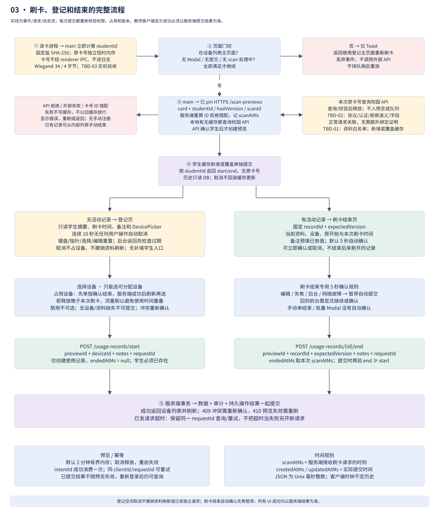
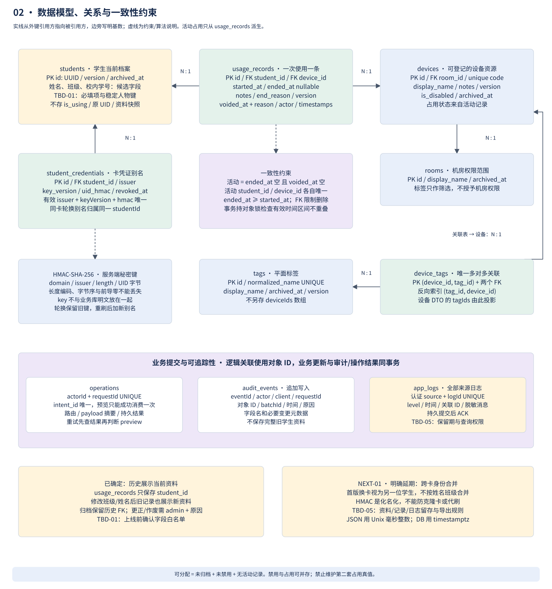
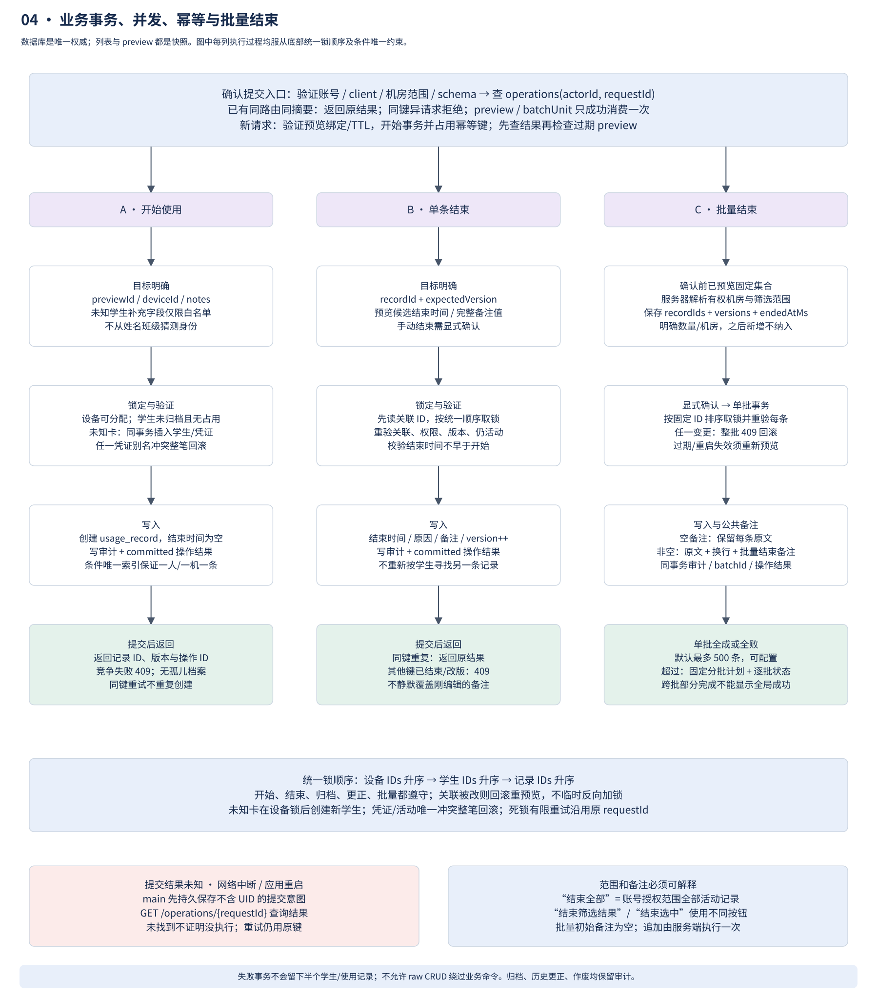

# 刷卡登记版业务与接口规格

基线：2026-10-28；决策依据和未确定事项见[决策登记](decisions.md)。本文件规定设计目标，不代表代码已完成。`usage_record` 是记录一次使用的条目，不套用完整三端方案的解锁/暂停 Session 状态机。

## 职责与范围

| 组件 | 负责 | 数据边界 |
| --- | --- | --- |
| 教师 Electron renderer | 页面、输入、倒计时、设备选择、确认/取消、错误和刷新 | 仅显示最小 DTO；没有校园卡 API 密钥、数据库连接或任意系统调用 |
| 教师 Electron main/preload | USB CardReader、设备/账号凭证、REST 客户端、受限 IPC、日志持久队列、提交恢复 | 校验 IPC 来源和 schema；读卡仅输出结构化事件，原始 UID 不进日志或持久业务缓存 |
| Fastify 服务端 | 身份解析、最小资料获取、业务规则、权限、并发占用、批量事务、审计/日志、查询 | 校园卡 API 仅此处调用；请求体/响应体按白名单，默认不记录敏感 body |
| PostgreSQL | 档案、卡指纹映射、设备、标签、使用记录、幂等结果、审计及应用日志 | 唯一约束/外键/事务最终保证一致性；客户端无法直连 |
| 校园卡提供方 | 卡身份与资料查询 | TBD-02；响应只在服务端短时处理，提取必要字段后释放引用，不持久缓存完整响应 |
| USB 读卡器 | 输出卡事件 | TBD-03；先定义适配器及测试实现，不能声称驱动兼容已验证 |

服务端固定 LAN 地址；教师端只主动访问 HTTPS REST，不需要接收学生端连接。教师机器开机软件注册 `clientId` 和版本，账号登录后才能登记/管理；设备凭证只允许本机日志上传和启动报告。首版以 operator（有授权机房的登记/结束/查询）和 admin（档案/设备/标签/账号/导出/更正）划分权限；权限在服务端校验，不以隐藏 UI 代替。首次管理员通过部署 secret 引导创建，随后失效；不提供默认密码。账号凭证生命周期、口令散列与限速采用成熟实现，不自制认证算法。

完整三端方案的每秒/20 秒监督心跳不用于本版；本版断线显示离线并禁止新业务写入，不控制学生电脑。设备列表默认前台 3 秒短轮询；切后台暂停，失败退避；响应标注服务器时间和数据版本。服务端不可达时保留当前显示但明确过期，不能继续离线创建或自动结束记录。

## 刷卡与页面状态机



1. CardReader 产生结构化 `scanId`、读卡来源和标准化卡字节，main 防抖，仅将 scan 元数据通过受限 IPC 送入页面门控；原 UID 留在 main 短期内存，门控允许后由 main 发往服务端，不交给 renderer。拒绝、取消或超时即释放原 UID 引用。协议未知前用 FakeCardReader；普通键盘输入不能默认当成刷卡。一个正在处理的 scan 不重复分流，短间隔同卡重复事件合并；硬件防抖阈值经实机确认，服务端幂等才是最终重复保护。
2. **只有设备列表主页面且无 Modal、无提交、无刷卡处理时**，可进入登记流程。其他页面/Modal 收到刷卡只显示“接收到刷卡消息，请返回主页面以触发登记”；不保存一队稍后自动触发的刷卡，不打断编辑，返回主页面后需要重新刷卡。
3. 客户端发送 `POST /api/v1/scan-previews`，服务器记 `scanAtMs`、解析卡指纹，并查询是否有活动使用记录。响应返回不含原始 UID 的短期 `previewId`、模式、当前资料、记录版本和服务器时间。preview 绑定账号/客户端，默认 2 分钟过期，存短期内存候选状态；服务端重启使其失效，需要重新刷卡，不让过期页面继续提交。
4. 若该卡没有活动记录，进入**登记页**。已知学生读取当前资料；未知卡由服务端调用校园卡 API（超时/有限重试/熔断），只接受 TBD-01 白名单字段。需要人工补充时在页面填写获允许字段。API 失败、身份不存在或资料不足显示可恢复错误，不生成学生或使用记录；未获授权的“手工跳过”入口不提供。校园 API 可暂时不可用但已存在且可用的学生档案仍可登记，不在每次刷卡强依赖外部刷新。
5. 登记页显示当前最小学生信息、刷卡开始时间、备注和设备选择器；没有可分配设备时禁用确认。默认 5 秒自动取消；确认提交成功才创建学生（若未知）及记录，`endedAtMs=null`。取消/倒计时取消不创建学生、不占用设备；服务器预览候选过期清理。
6. 若该卡有活动记录，进入**结束页**。显示当前资料、原开始时间、本次刷卡结束时间、设备，备注框预填当前备注；默认 5 秒自动确认，也可取消或立即确认。提交针对明确 `recordId + expectedVersion`，不能因这条记录已结束而顺手结束同一学生后来新开的记录。
7. 提交成功返回设备列表并刷新；遇到冲突显示原因及新状态，要求重新确认。网络超时保留原 `requestId` 并查询操作结果，不自动生成新请求。UI 上“返回”不等于撤销已经送出的命令。

倒计时从必要资料和页面可交互后开始；编辑、切后台或失焦会暂停自动动作，回前台后不能静默执行已经到期的提交，需显式继续倒计时或确认。人工点击和到期回调共用一次提交状态；任何错误、版本变化和页面离开都终止旧计时器。登记取消与结束自动确认的默认值保持草图定义，批量操作另有显式确认规则。

## 时间与身份

`scanAtMs` 来自服务端接受刷卡请求的时刻，客户端时钟只作显示/诊断，不决定历史。开始/刷卡结束采用此时间，手动/批量结束采用服务端生成预览时的候选时间；提交时再次验证 `end >= start`、预览未过期。实际提交时间另存 `createdAtMs/updatedAtMs`，不得混同刷卡时间。所有 JSON 时间字段是 Unix 毫秒整数或明确的 `null`，时长字段为非负整数；序列化必须验证 JavaScript 安全整数范围。展示按学校时区转换，数据库用 `timestamptz`；不在 API 返回本地化字符串当时间戳。

服务端在持有关联设备/学生锁时检查有效使用区间不得重叠，采用半开区间 `[started_at, ended_at)`；结束为空则视作无上界。历史补录/更正也走同样的锁与区间检查。例如 10:00 刷卡后才把目标设备原记录于 10:01 结束，不能用旧预览在该设备创建 10:00 开始的记录：返回 `TIME_RANGE_CONFLICT`，要求重新刷卡取得新的开始时间。DevicePicker 的“结束占用”成功后刷新可选状态，但不擅自把原刷卡时间改成提交时间。对零时长记录允许等值边界，不生成负时长。

卡规范化保留发行方命名空间、UID 长度、字节序和前导零；最后两项取决于读卡协议 TBD-03。服务端计算 `HMAC-SHA-256(secret, domain || issuer || length || uidBytes)`，字段使用明确长度编码，禁止模糊字符串拼接。数据库只保存指纹和密钥版本；原 UID 在请求/内存处理后释放，不写本地队列、日志、追踪、错误信息或磁盘。JavaScript 的垃圾回收不能保证秘密字节立即物理擦除，因此“即时销毁”落实为不落盘、不缓存完整响应、缩短作用域，不能宣称已安全擦除内存。

`studentId` 为内部 UUID；卡指纹唯一映射该 ID。没有经确认的稳定人物键时，同姓名/班级也不合并。换卡视为新学生档案是首版已定限制 NEXT-01。HMAC 秘密密钥轮换必须保留旧键查找并在重新刷卡时添加新版本映射；无原 UID 无法离线全量重算。轮换/双键迁移要有维护计划、事务去重及校验，未完成前不能删除旧键；密钥丢失会导致原卡映射不可找回，备份必须包括加密密钥材料。

## 数据模型与约束



下表不是最终学生资料 schema；带 TBD-01 的列仍待确认。所有业务主键使用 UUID，`version` 为每次修改递增的整数。数据库标识由服务端生成，不把可改名称、卡号或设备编号当外键。

| 实体 | 字段与约束 | 说明 |
| --- | --- | --- |
| `students` | `id` PK、候选 `display_name/class_name/school_number`、`archived_at`、`version`、创建/更新时间 | 姓名/班级/校内学号是否必填为 TBD-01；学籍号默认不收集；不存 is_using、不存资料整份响应 |
| `student_credentials` | `id` PK、`student_id` FK、`issuer`、`key_version`、`uid_hmac`、`revoked_at`；有效 `(issuer,key_version,uid_hmac)` 唯一 | 支持密钥轮换别名但首版不自动换卡合并；raw UID 不落库 |
| `devices` | `id` PK、机房范围 `room_id` FK、唯一可显示 `code`、`display_name`、`is_disabled`、`notes`、`archived_at`、`version` | code 是管理编号；禁用是管理属性，正在使用是派生属性 |
| `rooms` | `id` PK、`display_name`、`archived_at` | 机房为明确授权范围；分区可用标签筛选，不能通过改 tag 获得机房权限 |
| `tags` | `id` PK、`display_name`、规范化名称唯一、`archived_at`、`version` | 首版平面标签；“机房一/东区”等展示不代表树形权限继承 |
| `device_tags` | `(device_id,tag_id)` 复合 PK、两个 FK；另建 `(tag_id,device_id)` 索引 | 一份关系双向查询；设备 DTO 可投影 tagIds，标签 DTO 可按需查询设备，不双写列表 |
| `usage_records` | `id` PK、`student_id/device_id` FK、`started_at`、可空 `ended_at`、`notes`、`end_reason`、`voided_at/reason`、`version`、操作者与时间 | 一次登记一条；活动=`ended_at IS NULL AND voided_at IS NULL`；`ended_at >= started_at`；结束/作废均需业务规则 |
| `operations` | `(actor_id,request_id)` 唯一、可空 `intent_id` 唯一、规范请求摘要、状态、持久结果、时间 | 路由计入摘要；同键不同 payload 拒绝；preview 或批次单元的 intent_id 只能成功消费一次；响应丢失查询原操作 |
| `audit_events` | `event_id` PK、actor/client、操作/对象 ID、时间、原因、必要变更元数据 | 追加写入，保留更正/作废/批量行为；学生字段变更默认记字段名，不存整份旧资料快照 |
| `app_logs` | `log_id` + 认证来源唯一、source/level、时间、版本、关联 ID、脱敏 message | 客户端和服务端全部已产生日志归集；访问控制与保留期见 TBD-05 |
| `operators/client_credentials` | 账号角色/机房权限/认证凭证生命周期、客户端身份 | 账号权限和客户端日志身份分开；不在日志表保存认证秘密 |

学生当前使用通过活动记录查询；禁止学生表、设备表再写另一套活动记录 ID 或 is_using。查询可使用视图/索引优化，未来缓存也必须可从记录重建，不成为新真值。

约束示意（部署 migration 中实现，当前仅文档）：

```sql
CREATE UNIQUE INDEX one_active_record_per_student
  ON usage_records (student_id)
  WHERE ended_at IS NULL AND voided_at IS NULL;
CREATE UNIQUE INDEX one_active_record_per_device
  ON usage_records (device_id)
  WHERE ended_at IS NULL AND voided_at IS NULL;
ALTER TABLE usage_records ADD CONSTRAINT valid_time_range
  CHECK (ended_at IS NULL OR ended_at >= started_at);
-- device_tags 的复合主键已保证 (device_id, tag_id) 唯一。
CREATE INDEX device_tags_by_tag ON device_tags (tag_id, device_id);
```

“可分配”定义为设备未归档、未禁用且无活动记录。禁用与占用可以并存：教师可以禁用正在使用的设备以阻止下一次分配，但它仍在“使用中”展示，并带“禁用”标记；禁用不自动结束现有记录。归档前须结束活动记录。档案或设备已有历史时不物理删除，外键采用限制删除；更正历史时间/关联须 admin、原因和完整事务校验。

学生改班级/学号直接更新当前档案；使用记录通过 `student_id` 关联显示最新资料，导出也按导出当时最新资料生成，不额外建学生快照。并非“旧记录永远显示原班级”。若学校未来需要历史快照，应作为新需求迁移，不能偷偷改变本轮已解决的选择。

## 业务事务和批量操作



**开始使用：** 认证/权限及输入校验 → 幂等键占位 → 按下述统一顺序锁定目标设备与学生 → 检查未归档、未禁用、无活动记录 → 写使用记录、审计、操作结果 → 同一事务提交 → 回成功。未知卡在锁定设备之后创建学生及凭证，凭证唯一约束冲突则整笔回滚并返回 409 要求重新预览，不在原事务内改锁另一位学生。竞争失败回滚所有新建档案/记录；不存在“学生建好了但登记失败留半条”的隐式成功。

**结束使用：** 仅使用明确 `recordId + expectedVersion`，先读取关联 ID，再按统一顺序锁定设备、学生、记录，重新核验关联未变及权限、版本、活动状态和时间范围 → 写结束时间/备注、递增版本、审计与操作结果 → 同一事务提交。重复同键返回原结果；不同键遇已结束则返回冲突/当前结果，绝不把 end 请求当“按卡切换开始/结束”。所有开始、结束、归档、更正与批量路径遵守统一锁顺序（设备 ID、学生 ID、记录 ID，各自排序）；关联变更时整笔回滚重新预览，不在持锁中临时反向加锁。死锁有限重试仍用同一幂等键，条件唯一约束兜底。HMAC 轮换期间同卡所有可查旧/新指纹都作为唯一凭证别名在同一事务检查/写入，冲突整笔回滚，防止两个密钥版本各建一个学生。

**备注：** 开始时可空；刷卡/手动结束与普通备注编辑加载已有值，并用 `expectedVersion` 防止覆盖别人刚写的内容。单条结束采用已确认的完整编辑值。批量备注框初始为空；非空时每条保存为 `原有备注 + 换行 + 批量结束备注：XXX`，原备注为空则无前导换行，公共备注为空则保留原备注。拼接发生在已锁定行的服务端，幂等重试不能重复追加。

**单个手动结束：** 在设备行打开 Modal，内容与刷卡结束页一致，但没有 5 秒自动确认。只结束预览的当前记录，页面背后新的刷卡只 Toast。

**结束多台 / 全部记录：** 服务器按账号授权范围解析选择，返回固定 ID/版本集合、条数、设备/学生摘要和候选结束时间；顶部按钮明确显示范围，不把“本页”“筛选结果”“有权限的全部机房”混为一谈。默认“结束全部记录”指该账号有权限范围内的全部活动记录，确认对话框明确列出机房和数量；如仅结束筛选结果，使用不同按钮文本。

确认提交必须携带该预览标识及版本；后台之后新增的记录不在集合中。首版单批上限为可配置 500 条，不是设备总数限制；超过则服务端生成固定的分批计划，UI 明示各批状态，不能给一个全局成功掩盖部分失败。每批只要有一条版本变化、权限不符或已结束，整批 409 回滚并要求刷新确认；重复同键返回原结果。同一批的审计包含 batchId、各 recordId、操作者、理由和原始范围。

每个可确认 preview（或大批计划中的单个 batchUnit）由服务端生成唯一 `intentId`，同业务和操作结果一起持久消费；数据库 `operations.intent_id` 唯一约束禁止换一个 requestId 重复使用同一预览。只有成功提交才消费，失败事务回滚；重复同 requestId 返回原结果，不同 requestId 再消费返回 `PREVIEW_ALREADY_USED`。单凭“把内存 preview 删除”不够，必须覆盖并发请求、进程重启及后来再次空闲的场景。批量计划的每个单元独立消费，不把首批成功误认为整个计划已消费完毕。

学生/设备/标签支持单条和批量管理；导入先提供字段校验/重复冲突的预览，确认后按同样的有限批次规则提交。档案字段未定前不发布最终 CSV 模板。使用记录禁止一般用户裸 CRUD 绕开占用规则；历史增加、更正、作废是带原因的 admin 命令，仍受时间、权限与唯一约束保护。

## REST 契约

接口族统一带 `/api/v1` 前缀，下表省略此前缀；健康检查独立位于 `/health/*`。除公开健康检查和受限引导外均需认证，所有网络请求均用 TLS；账号访问 token 只交 main 使用，长期凭证用操作系统保护存储，renderer 不得接触。主进程 API 封装与服务端共用 `protocol` DTO/schema；最终规则由服务端执行业务事务。

| 接口族 / 示例 | 含义与关键输入 | 返回 / 错误 |
| --- | --- | --- |
| `POST /auth/login`、`/auth/refresh`、`/auth/logout` | 账号认证，配套限速与撤销 | 会话与角色/机房范围；401/403，不回秘密 |
| `POST /clients/register`、`/clients/startup` | 受控入网、身份/版本报告 | 客户端身份/兼容性；自报角色不提权 |
| `POST /scan-previews` | `scanId`、卡来源和 UID（敏感，仅处理时使用） | `previewId/mode/scanAtMs/expiresAtMs/student/activeRecord`；未知卡查询失败可重试，无业务写入 |
| `DELETE /scan-previews/{id}` | 仅创建账号/客户端取消候选 | 幂等释放临时资料；取消请求未到达时由 TTL 兜底，不撤销已提交业务 |
| `POST /usage-records/start` | `previewId/deviceId/notes/requestId`，未知学生可带白名单补充字段；已知档案修改另走有权限的管理接口 | 201 新记录和操作 ID；409 冲突、410 预览失效、422 资料缺失 |
| `POST /usage-records/{id}/end-preview`、`/end` | 手动预览；确认带 `previewId/expectedVersion/notes/requestId`，时间取绑定的预览 | 记录及操作结果；拒绝错误目标、过期版本和重复切换 |
| `POST /usage-records/end-batches/preview`、`/confirm` | 精确选择或授权范围、预览 ID、公共备注、幂等键 | 固定集合/分批计划与逐批事务结果；409 必须重预览 |
| `PATCH /usage-records/{id}/notes` | `expectedVersion/notes/requestId` | 新 version；不静默覆盖并发修改 |
| `POST /usage-records/{id}/correct`、`/void` | admin、原因、预期版本及允许字段 | 追加审计；不裸删除历史 |
| `GET /devices`、`/tags`、`/students`、`/usage-records` | 分页、机房权限、状态/标签/时间筛选 | 最小字段、服务器时间和版本；无 raw UID/HMAC/学籍号 |
| `POST/PATCH /students`、`/devices`、`/tags` 及各自 `/batches` | admin、版本、校验后的最小资料/关系；归档走明确动作 | 按业务约束增改/归档；设备 tagIds 事务更新关联表 |
| `GET /operations/{requestId}` | 同一账号已提交请求的状态查询 | committed/result；未找到不自动证明原请求未执行，重试仍沿用同键 |
| `POST /logs/batch` | 设备身份、稳定日志 ID/来源/级别/时间 | 仅持久提交后 ACK；部分成功只确认已保存项 |
| `GET /health/live`、`/health/ready` | 存活与数据库/schema 版本就绪 | 200 或 503；不对外暴露连接串、目录及秘密 |

所有写操作使用幂等键和规范请求摘要，服务端给稳定错误 `code`、安全消息和 `requestId`。401 需恢复登录；403 权限拒绝；409 业务/版本冲突；410 预览过期；422 输入错误；429 按退避；503 服务或上游不可用。日志 API 同样有限批量/消息上限，不允许无限 body。生产接口不能接受客户端任意 SQL、表名或待编译 schema。

preview 过期后，**已提交的操作**仍可用 requestId 查到；恢复流程必须先查/重放幂等结果再判断 preview 失效。主进程持久保存不含原始卡号的提交意图（previewId、recordId/deviceId、version、requestId 等必要字段），应用重启后恢复查询；尚未发送的过期预览作废要求重刷，不离线制造业务。

## 日志、故障与验收边界

延续项目“所有组件已产生日志上传服务端”的要求：教师 main/renderer/reader adapter/SDK/安装与更新日志全部本地持久排队、确认后回收；服务端/数据库等部署组件日志经内部收集写统一存储，数据库故障时先本地持久缓存。图中两级日志交接不是校园卡资料缓存。原 UID、provider 响应、HMAC 密钥、token、学生学籍号和未经必要性确认的个人字段不得出现在日志。

传输失败保留稳定 logId 重试；stdout/容器轮转不是唯一日志副本，未完成持久交接的日志不能被自动清理。日志输入不能递归记录自身每次写入。无法持久保存业务审计时拒绝业务写入，显示故障；没有学生端，故障不关机也不执行锁机。详细故障、并发、重启和安全场景必须通过[两端测试矩阵](testing.md)，而不是以截图或覆盖率百分比替代。
