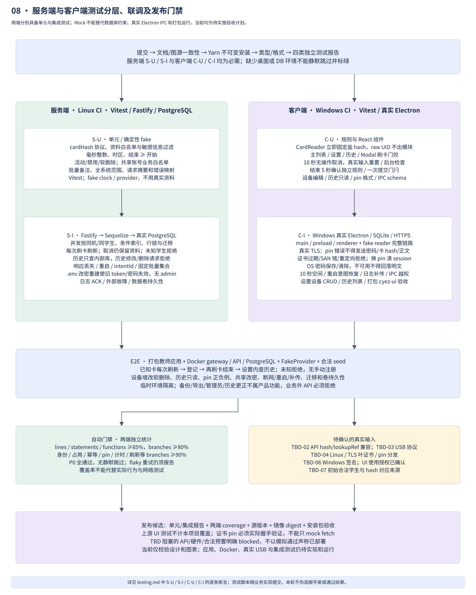

# 服务端与客户端测试设计

2026-10-31 覆盖修订：S-I-06/07/12/18 与 E2E 改按“API 权威、本地仅缓存”验收。空学生表首次有效刷卡须调用 provider 并创建缓存；再次刷卡须调用 provider 并覆盖缓存；provider 拒绝或故障不得插入、覆盖或用旧缓存放行；错配 ID 仍不得查询 provider；历史/列表只读缓存；并发旧响应不得覆盖新资料。旧文中“预置合法学生、未知本地 ID/停用拒绝且不查询 provider”的断言已撤回。集成 seed 只用于旧数据兼容测试，不是生产前置。

2026-10-29 按 [opinions.md](../opinions.md) 及后续卡号临时查询/哈希学生 ID 确认修订。**两端各自必须具备单元测试和集成测试。** 下述矩阵是目标验收清单；当前已执行范围、环境与剩余缺口见[测试报告](verification-report.md)，不能把文档图表校验算作产品测试通过。

## 测试分层

| 层 | 对象及真实边界 | 工具与环境 |
| --- | --- | --- |
| S-U 服务端单元 | studentId 重算与卡号绑定、资料白名单、时间/备注/规则、共享认证、业务 DTO 白名单 | Vitest，假时钟/ID/provider；不用生产资料 |
| S-I 服务端集成 | Fastify 路由 → 服务 → Sequelize 模型/事务 → **真实 PostgreSQL**，migration/索引/行锁 | inject + 临时 PG；另起实际 gateway/TLS 进行网络测试 |
| C-U 客户端单元/组件 | CardReader 立即 hash、页面门控、空闲/自动确认计时、设备/历史/设置组件、pin 输入规范化 | Vitest + Testing Library，fake reader/clock/network |
| C-I 客户端集成 | **真实 Electron** main/preload/renderer，实际 SQLite、临时 userData、OS 保存、真实 HTTPS/pin | Windows + 固定 Playwright Electron（实验性），FakeCardReader，可控 HTTPS 服务和测试证书 |
| E2E | 打包教师应用 + Docker gateway/API/PG + FakeProvider，空学生缓存 | 真实请求/持久层；包含首次刷卡建缓存、API 明确拒绝、重复刷卡刷新、只读历史、改密与设备编辑 |
| 实机 | USB、驱动、签名、安装升级、多 DPI/键盘/屏幕阅读器、Linux/TLS | TBD-02/03/04/06 闭合后验收，mock 不能代替 |

测试和种子工具也通过 ORM/迁移 API 操作数据库，不用手写 SQL 绕开应用约束。客户端 SQLite 使用 ORM/结构化库 API；服务端集成不能用 SQLite 代替 PG，客户端集成不能只用 jsdom。证书 pin 测试必须使用实际 TLS 握手，单纯 mock fetch 无法证明凭证发送前已校验证书。

## 服务端矩阵

| ID | 场景 | 关键断言 |
| --- | --- | --- |
| S-U-01 | studentId/hashVersion/发行方、原卡号与 schema | 共享向量重算得到同一 64 位 hex；错误 ID/版本拒绝且不调用 provider；StudentDTO 仅 id/白名单资料，无原卡号/盐/密码；校验错误不回显请求 |
| S-U-02 | 毫秒安全整数、结束 ≥ 开始、区间边界 | null/时区/负时长处理正确，等值边界可用 |
| S-U-03 | 活动/禁用/软删除、全系统范围 | 已删除不可分配，禁用不隐式结束；所有合法教师可操作任意设备，无 admin/机房条件 |
| S-U-04 | 批量备注、摘要、资料白名单 | 公共备注空保留，非空精确追加；同键异 payload 拒绝；额外资料不落库 |
| S-I-01 | 两客户端同学生/同设备并发登记 | ORM 真实连接+事务后仅一条活动记录；数据库条件唯一索引生效 |
| S-I-02 | 新增/修改/删除设备，与登记并发 | 设置对应接口可用；活动设备删除 409；软删除保留历史关联；无重复 code |
| S-I-03 | 响应丢失/重启/改密后同键查询 | 操作结果持久，重新认证后原 clientId/requestId 不重复执行；preview 失效不遮住已有结果 |
| S-I-04 | 结束/活动备注竞争，历史变更请求 | expectedVersion 防覆盖；结束后任何备注修改/更正/删除均拒绝，无新记录误结束 |
| S-I-05 | 批量固定集合/后来新增/单条冲突 | 后建记录排除，单批全回滚，跨批结果明确；全系统范围不受标签权限限制 |
| S-I-06 | 首次与重复刷卡，历史重复查询 | 空缓存首次刷卡调用 provider 并插入资料；再次刷卡调用 provider 并覆盖；历史展示最新 DB 值，查询 provider 调用计数不增加；取消预览不撤销缓存更新 |
| S-I-07 | API 拒绝、故障与字段校验 | API 明确拒绝不新增缓存；故障或无效资料不覆盖旧缓存、不允许旧数据刷卡提交；合法响应不必回传卡号；协议若有卡号引用则不符时报错；手动结束可继续 |
| S-I-08 | 共享账号、任意设备、业务外端点 | 合法同账号两端可用全设备；无 admin/学生注册/导出/运维/任意表接口；401/413/422/429 明确 |
| S-I-09 | 日志 ACK 丢失/DB 不可写/ORM 日志输出 | 稳定 ID 去重，提交后 ACK；参数/body/原 UID/studentId/密码不进入 app_logs；审计只保留必要 student_id FK/字段名；教师不能读取服务器日志 |
| S-I-10 | 空库 ORM migration、已有数据升级、失败迁移/重建 | 条件索引/FK/迁移版本正确，失败阻断 ready，卷数据不丢；生产不使用 sync force/alter，无备份导出要求 |
| S-I-11 | preview 换键/并发消费/重启/后来再次空闲 | intentId 只成功消费一次，同键返回原结果，批次单元分别幂等 |
| S-I-12 | 旧刷卡时间、资料刷新并发/乱序 | 重叠时间拒绝；同学生刷新串行，旧响应不能覆盖新资料；provider 查询中缓存版本变化则拒绝旧结果，preview 版本变化明确冲突 |
| S-I-13 | .env 改密与 API 重建 | 新密码生效、旧密码和旧 token 拒绝；无在线改密/admin；日志保留到重新认证后补传 |
| S-I-14 | 原卡号 → API、学生哈希 PK/FK、内存生命周期 | FakeProvider 实际收到无损原卡号（含前导零），不是哈希；错配 ID 不更新任何学生；PG/SQLite/spool/operations 无原卡号，预览无 card；成功/错误/超时/取消清理；真实 gateway 不产生 body 临时文件；PK/FK 同为 STRING(64)，拒绝孤儿关联 |
| S-I-15 | Compose 端口与网络隔离 | LAN 只通 gateway；API/PG/log-ingest 无宿主发布端口；网络成员仅项目服务，gateway 不入 DB 网络；无 Docker socket 挂载；provider 出口正常 TLS |
| S-I-16 | DB/spool 容量水位、停 ingest、只读/写满磁盘 | 按实施计划进入预警/受限/持久失败/恢复状态；限制新登记但保留可用查询/可持久结束；不全站误返回 503；无虚假 ACK、未 ACK 删除或重启循环；底层共盘容量合并监测 |
| S-I-17 | 日志长时间积压、轮转、恢复补传 | 各来源稳定 ID 去重、已生成日志不采样丢弃、未 ACK 段不轮转删除；归集不递归产生日志；报告峰值速率/最老年龄/追赶时间；测试规模不成为设备数上限 |
| S-I-18 | 集成 ORM seed 与旧库兼容 | 共用规范哈希规则；集成 seed 可重复执行，冲突报错并整批回滚；不覆盖刷卡资料；生产 CLI 拒绝 seed；原卡号不落盘/日志；空缓存首次刷卡可由 API 成功结果建立 |

## 客户端矩阵

| ID | 场景 | 关键断言 |
| --- | --- | --- |
| C-U-01 | 主列表/设置/历史/Modal/提交中刷卡 | 只有合格主列表请求 preview；其他只 Toast，无 provider 请求或排队重放 |
| C-U-02 | reader 立即 hash、跨客户端/服务端/seed、前导零/长度/字节序 | 相同规范卡号得相同 studentId；不同盐/版本/发行方有明确隔离；CardScanInput 独立于 StudentDTO；原卡号仅在读卡继承管道及本次查询内存/HTTPS，不进 renderer IPC/日志/SQLite；重复 scan 合并 |
| C-U-03 | 10 秒无操作，9.9 秒输入，持续编辑，后台/唤醒 | 真实活动重置；轮询/合成事件不重置；后台返回先清过期；只取消不提交；提交后不触发空闲取消 |
| C-U-04 | 结束页 5 秒确认/编辑失焦、按钮竞争 | 自动提交暂停并需显式恢复；仅一次动作；手动/批量 Modal 从不自动确认 |
| C-U-05 | 设置/设备/历史组件，pin 输入 | 两个一级入口正确；历史无编辑删除导出；pin 规范化长度正确，错误清晰；设备状态不可误选 |
| C-I-01 | 真实 Electron/cyez-ui/窗口/路由 | 独立 userData、单份 React、沙箱与隔离开启，无旧仓库路径 |
| C-I-02 | 独立 Rust mock → main → preload → renderer | main 收到 UID 后立即计算 studentId；main 以临时 card 数据请求 HTTPS，renderer 仅收学生 DTO；主页面门控生效，拒绝事件释放卡号；订阅不泄漏 |
| C-I-03 | 断网/超时/会话失效/空闲边界 | 不显示虚假成功，原键恢复；后台过期登记不复活，结束页恢复不偷提交 |
| C-I-04 | 提交后 kill Electron、重启/换服务器 | SQLite 意图恢复，查询原结果；不存 UID/hash；旧服务器意图绝不发给新 origin |
| C-I-05 | 日志重启/断网/ACK 丢失/磁盘失败 | 全部日志持久补传和去重；未确认不删；记录不了就明确报错 |
| C-I-06 | IPC 越权/任意 URL/导航与窗口来源伪装 | sender/schema 拒绝；renderer 无原始凭证/任意网络或系统权限 |
| C-I-07 | 干净 tarball 消费与打包 Windows 应用 | 单份依赖、main/preload 分包、可执行文件运行；上游测试不计本项目通过 |
| C-I-08 | 设备 CRUD/删除占用/历史视觉交互 | 编辑冲突、删除确认和软删除；历史筛选/分页/固定表头/详情抽屉/空态/窄窗口/键盘可用，历史读取无 provider 调用 |
| C-I-09 | 实际 HTTPS pin 正负例与证书更换 | 正确自签名 pin 无系统导入可用；错误 pin（包括系统信任证书）、过期、SAN 错、重定向/HTTP 都拒绝；服务端证实失败握手后未收到密码/原卡号/studentId/body |
| C-I-10 | 保存密码/清除/不可用/改 IP 或 pin | OS 加密文件不含明文；加密不可用不回落明文；清除生效；新 session 不复用旧校验缓存，重新认证 |
| C-I-11 | 刷卡失败/取消/重启、普通提交重试边界 | 刷卡不进持久队列、不自动重放；重新刷卡才再次查 provider；main/renderer 错误、trace/日志无原卡号；内存请求引用释放后无应用级缓存，不宣称能证明 GC 物理擦除 |
| C-I-12 | 本地 outbox/提交意图空间不足与恢复 | 预警明确，持久失败不发送新业务或伪装保存成功；已发请求仍显示待确认；不删除未 ACK 日志；恢复空间后沿原键查结果并补传，不离线补记时间 |

## 读卡子进程验证

2026-10-30 增补：Rust `cargo test --locked` 校验 Wiegand-34 位/奇偶、8 位 UID 与 shutdown；客户端实际 spawn Rust release exe 校验握手、前导零、生产拒绝 mock、关闭和重启；用独立故障子进程验证分片/多帧/CRLF、超长/畸形消息、握手超时、缺少可执行文件、提前退出和强制关闭。真实 Electron 套件验证自动启动及打包资源路径；另用原生窗口手动输入验证 scan 输出。所有这些均不能替代 TBD-03 真实硬件。

## 联调与门禁

完整联调从**空学生缓存**开始：刷卡从 API 建缓存 → 选设备 → 开始 → 再刷卡覆盖缓存 → 结束 → 设置内查历史；另测 API 明确拒绝、外部故障转手动结束、标签跨区域设备、全系统批量、设备编辑/删除、10 秒空闲、共享改密、pin 错误、应用/DB 重启和日志补传。

CI 依次执行文档/图源校验、不可变 Yarn 安装、类型/格式、服务端与客户端独立单元报告，Linux 真实 PG 集成、Windows Rust fmt/test/release build、真实 Electron 集成，然后构建 Docker/客户端包并联调。临时项目/数据库/userData 名称唯一，不指向生产；产出 coverage、失败截图/trace、版本和镜像 digest，测试材料不得含真实个人资料。

根 Yarn 调度脚本 `test:unit:server/client` 与 `test:integration:server/client` 已创建并运行；实际结果见[测试报告](verification-report.md)。两端分别 lines/statements/functions ≥85%、branches ≥80%；身份/占用/幂等/pin/计时/资料刷新/备注关键模块 branches ≥90%。阈值为项目门禁；生成代码和第三方库明确排除，不能排除失败路径凑覆盖率。

实施优先级、阶段产物与容量/故障状态的具体语义见[实施计划](implementation-plan.md)。全部矩阵场景是完成标准。P0 包括 S-I-01～05、07～18、C-U-01～04、C-I-03～06、09～12 及完整联调；不能静默跳过标绿，flaky 重试也报告。TBD-02/03/04/06 的真实输入缺失用例标 blocked，模拟通过不等于硬件已验证。产品不验收备份、导出、历史编辑/删除或管理员功能；这些接口必须不存在或拒绝访问。
