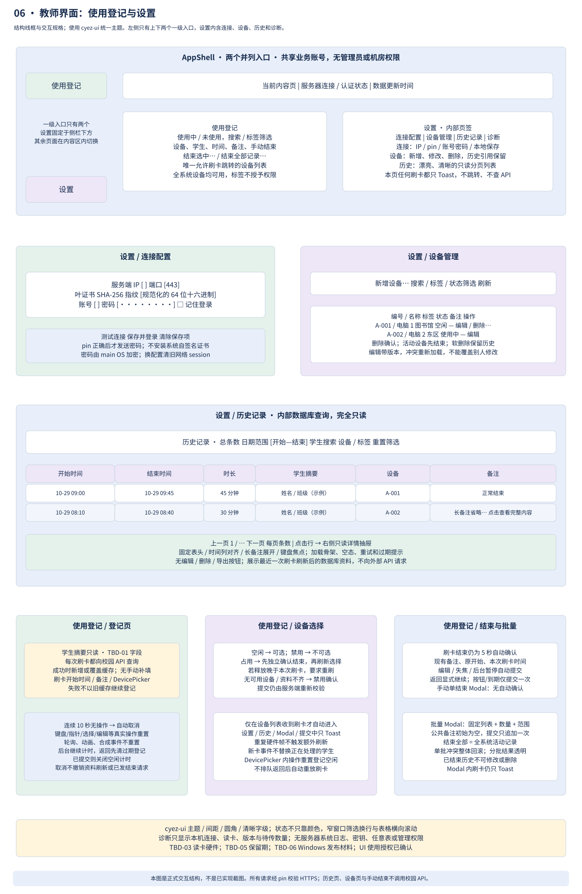
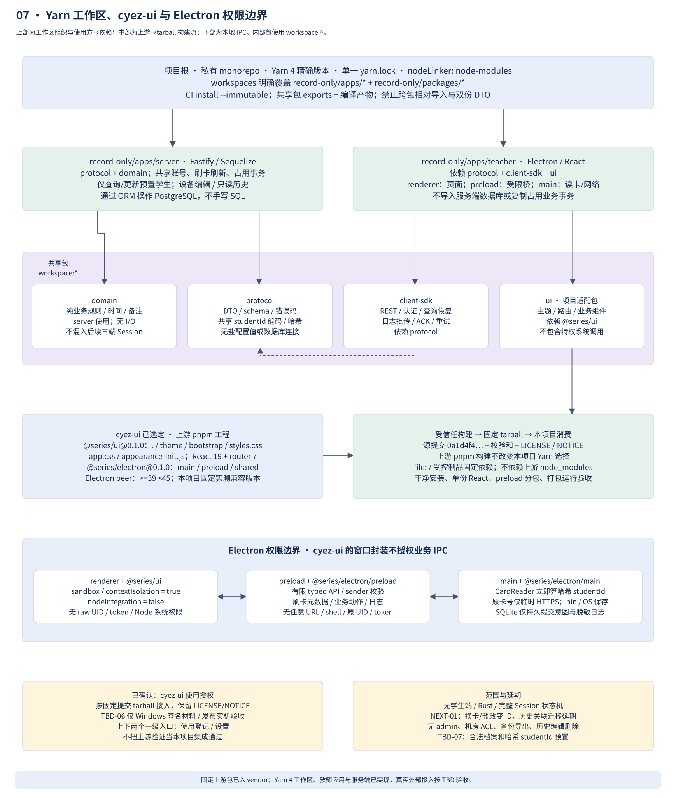

# 教师端界面与 cyez-ui 接入

2026-10-29 按 [opinions.md](../opinions.md) 及后续卡号/学生 ID 分离确认修订。界面库确定为 [cyez-ui](https://github.com/lmyzzzz/cyez-ui)，用户已确认取得授权。已核对上游提交 `0a1d4f4fa9affecb2eaf83e978c1e9b1557c7043` 的包入口；最终页面由本项目实现和测试。

## 两个一级入口

左侧侧边栏上方为**使用登记**，下方固定为**设置**，两者是仅有的并列一级入口。登记页/结束页是使用登记内流程；连接配置、设备管理、历史记录、诊断为设置内部页签/二级导航，不再把账号、学生、机房权限或历史作为独立一级入口。

AppShell 显示产品名、服务器连接/认证状态、数据更新时间，不显示 admin/operator 角色和机房授权范围。未连接/未登录时可以进入设置配置连接，不能查询业务。所有合法教师可以操作全部设备，标签仅筛选。

## 页面和交互

| 页面/组件 | 布局与内容 | 行为 |
| --- | --- | --- |
| 使用登记 / 设备列表 | 使用中与未使用选项卡；搜索/标签筛选；设备、当前学生、开始时间、时长、备注；结束选中/结束全部 | 唯一可由刷卡自动跳转的页面；Modal 或提交中仅 Toast；全部为全系统活动记录 |
| 登记页 | 只读学生摘要、刷卡时间、备注输入、DevicePicker、确认/取消及空闲提示 | **10 秒无操作取消**；真实键盘/输入/点击/触摸/滚轮/指针移动重置；持续编辑不取消；后台返回先检查过期 |
| DevicePicker | 设备名/编号、标签、空闲/占用/禁用文字状态；搜索分页 | 空闲可选，禁用不可选；结束占用先单独确认，成功刷新后选择；释放晚于原刷卡须重刷以免重叠 |
| 刷卡结束页 | 当前学生资料、固定记录和设备、开始/结束时间、已有备注 | 保留 5 秒确认；编辑/后台/失焦暂停，返回显式继续；与登记空闲规则不同 |
| 单结束 Modal | 复用结束表单，默认已有备注 | 显式确认，无自动提交；过程中刷卡只 Toast |
| 批量结束 Modal | 紧凑固定记录列表、总数/筛选条件、初始为空的公共备注、确认结束 N 条 | 追加备注而非覆盖；冲突重预览；超批次显示各批结果；后来新增不纳入 |
| 设置 / 连接配置 | IP、端口、SHA-256 叶证书指纹、账号、密码、记住登录、测试连接、保存并登录、清除保存项 | pin 在发密码前校验；不安装系统证书；换目标重建网络 session；保存密码由 main OS 加密 |
| 设置 / 设备管理 | 顶部新增按钮、搜索/标签/状态，列表含编号/名称/标签/状态/备注/操作 | 添加、编辑、删除（确认后软删除）；活动设备需先结束；版本冲突不静默覆盖 |
| 设置 / 历史记录 | 筛选条、清晰分页表格、只读详情抽屉 | 仅读内部库，显示最近一次刷卡更新的学生资料；无修改/删除/备注编辑/导出按钮 |
| 设置 / 诊断 | 本机版本、reader 状态、服务器连接/证书摘要、待传日志数 | 不显示原卡号/hash/密码/token、服务器日志或系统配置；TBD-03 硬件仍待确认 |

所有刷卡资料由服务端本次刷新得到；库中未知学生显示“该学生未在系统中授权”，只允许返回/重刷，不提供补填资料或注册按钮。刷新失败不展示可提交的旧资料。历史查阅不会发校园 API；已结束记录在 API 侧同样只读，不能只隐藏 UI 按钮。

## 历史列表视觉规范

采用 cyez-ui 的主题色、圆角、文字层级和间距体系，内容区为独立面板；顶部标题“历史记录”配总条数，下一行放日期范围、学生关键字、设备/标签筛选及重置。表格固定表头，列为开始时间、结束时间、时长、学生摘要、设备、备注；时间等宽对齐，备注截断后可展开详情，不因长文本撑乱行高。按结束时间倒序、记录 ID 稳定次排序，服务端分页，避免把全部历史一次加载进内存。

行悬停和选中有轻背景差异，状态搭配文字，不仅靠颜色。点击行打开右侧只读详情抽屉，完整显示备注和记录 ID，没有编辑入口。底部分页和条数清晰可见；加载用骨架行，空结果解释筛选条件，失败提供重试，离线标明当前结果过期。窄窗口允许表格横向滚动，筛选项换行，不能裁掉主要动作；键盘焦点、Tab 顺序、屏幕阅读器表头关联和减少动画偏好都需验收。

## 计时与页面安全

登记空闲时钟从资料就绪开始，用单调时钟判断；本页和 DevicePicker 的可信活动重置，轮询/动画/合成事件/重复读卡不重置。后台也计空闲，到期只取消；回前台先退出过期页再接新操作。提交中不再执行空闲取消，不把页面退出当撤销请求。刷卡结束自动确认则在失焦/编辑时暂停，恢复需要明确动作；单结束/批量从不自动确认。

preload 仅提供限定业务动作与刷卡元数据，renderer 不接收原 UID、token 或可直接发任意 URL 的函数。StudentDTO 的 id 是卡号加盐哈希，只作业务关联，不在诊断或日志显示。CardScanInput 与学生资料分开，只在 main/服务端本次请求使用原卡号，校园 API 查询完成或失败后释放；不建立卡号展示/编辑/查询页。连接测试、pin 校验、密码保存和网络都在 main；同一业务 API 访问范围由服务端再次约束。设置/历史/设备编辑收到刷卡只 Toast，不查询外部、不存队列、不改变正在编辑的设备。

## 包与 Yarn 工作区边界

| 已核对上游包 | 入口与能力 | 项目用法 |
| --- | --- | --- |
| `@series/ui@0.1.0` | React UI、`/theme`、`/bootstrap`、`/styles.css`、`/app.css`、`/appearance-init.js` | 本项目 `packages/ui` 提供主题、导航适配与业务组件封装，renderer 消费；不供 server 引用 |
| `@series/electron@0.1.0` | `/main`、`/preload`、`/shared` 分离入口，窗口控制/状态同步 | main 和 preload 仅引用对应入口；业务 IPC 独立定义并验证 sender，不把 main bundle 导入 renderer |
| peer 依赖 | UI：React/React DOM `>=19 <20`、router `>=7 <8`；Electron 包：`>=39 <45` | 由应用显式声明并固定兼容版本，确保单份 React；最终 Electron 版本经 Windows/安装器测试决定 |

上游 pnpm 项目尚未在 npm 发布包，采用构建 tarball。实施时由受信任构建流程在固定上游提交构建并产出 `series-ui-0.1.0.tgz` 与 `series-electron-0.1.0.tgz`，记录源 commit、校验和与 LICENSE/NOTICE；项目通过受控制品或 `vendor/` 固定包消费，Yarn lockfile 记录校验。不能把 GitHub repo URL 当已构建 npm 包，不从浮动 main 在线安装生产依赖。

本项目内部依赖继续使用 `workspace:^`，UI 封装包可对外部 tarball 使用 `file:` 依赖；适配包构建不复制业务逻辑。`packages/protocol` 定义分离的 CardScanInput/StudentDTO schema 与 studentId 编码/哈希函数，由 main、server 和 seed 共用；固定盐值由部署配置注入，renderer 不调用读卡/哈希入口，也不接收原卡号。上游采用 pnpm 不要求消费项目改 pnpm，本项目只保留一个 Yarn lockfile。消费验收必须从干净目录安装、构建、检查单份 React、验证 preload 分离与打包运行，而非引用上游 node_modules 的偶然依赖。

在 renderer 保持 `sandbox=true`、`contextIsolation=true`、`nodeIntegration=false`；preload 仅暴露刷卡订阅、受控业务动作、必要窗口功能和日志接口。main 负责认证及网络，服务端承担业务最终判断。页面不允许任意外部导航、新窗口或直接校园卡 API 请求；UI 更新不能扩大 IPC 权限。

用户已在 opinions.md 明确确认取得 cyez-ui 使用授权，当前按已授权库接入，不再将许可列为待定或阻塞。仍随制品保留 LICENSE/NOTICE 和来源记录。TBD-06 仅保留 Windows 签名材料及发布验收。上游验证记录包含单元、浏览器和部分 Windows Electron 检查，但安装/卸载、不同 DPI/多显示器等仍有未验证边界；本项目必须独立验收。
